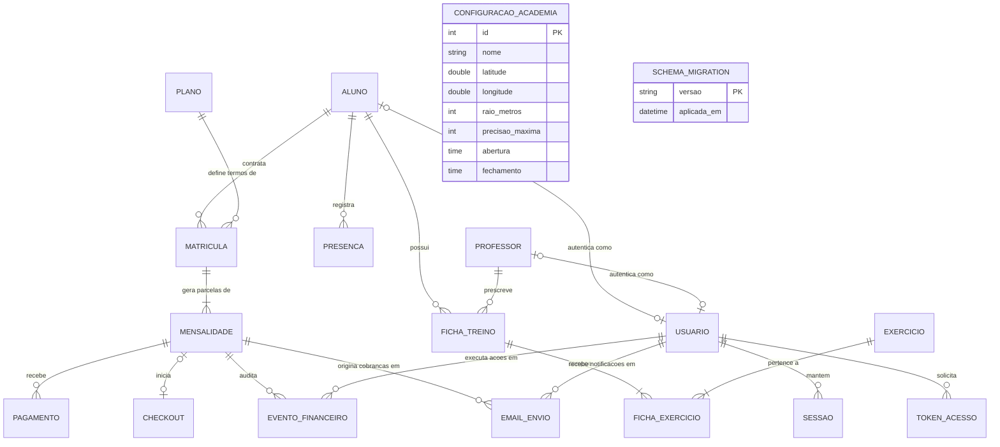

# FACULDADE UNINASSAU OLINDA
## CURSO DE ANÁLISE E DESENVOLVIMENTO DE SISTEMAS / CIÊNCIA DA COMPUTAÇÃO
### DISCIPLINA: FÁBRICA DE SOFTWARE (2026.2)
### ORIENTADOR: PROF. ITALO NUNES PEREIRA

---

# SISTEMA DE GERENCIAMENTO DE ACADEMIA SIGNY
## Documento de Especificação Técnica, Arquitetura de Software e Modelagem de Dados — Versão 1.4

**Olinda – PE**  
**Novembro de 2026**

---

### Equipe Técnica de Desenvolvimento e Engenharia de Software:

| Nome do Integrante | Matrícula | Papel na Fábrica de Software |
| :--- | :--- | :--- |
| **Juan Alencar de Barros** | 01621647 | Coordenador da Equipe e do Projeto / CI/CD e Backend |
| **Allan Victor Cavalcanti de Sá** | 01587571 | Engenheiro de Banco de Dados / DBA & Backend |
| **Fabiano Vitor de Holanda Coelho** | 01647936 | Engenheiro de Software Backend (Regras de Negócio & APIs) |
| **João Guilherme Nemesio Beltrão** | 01591539 | Desenvolvedor Frontend & UX/UI Designer |
| **Matheus Henrique Souto Dosquinha** | 01604657 | Desenvolvedor Frontend & Integração de APIs |
| **Gabryel Silva do Nascimento** | 01636496 | Analista de Testes e Qualidade de Software (QA) |

---

### Resumo Executivo da Versão 1.4

O presente documento formaliza a especificação de engenharia de software da **Versão 1.4** do **Sistema Signy**, plataforma de gestão abrangente voltada ao segmento de academias de ginástica, estúdios fitness e centros esportivos. Consolidando os avanços das Sprints 1 a 7, a versão 1.4 entrega um ecossistema operacional de alta maturidade com persistência relacional no **PostgreSQL 16+** (suporte híbrido a **Neon Cloud** e **PGlite WASM**), segurança baseada em papéis (**RBAC** com 4 perfis), automação financeira integrada ao gateway **Mercado Pago** (PIX dinâmico e cartão com confirmação idempotente via webhooks HMAC-SHA256), Progressive Web App (**PWA**) com Portal do Aluno, e os novos diferenciais da versão:
1. **Auto Check-in Geolocalizado por GPS (Geofencing):** Validação matemática em backend via Fórmula Esférica de Haversine, cálculo de raio de tolerância (10m a 1000m), filtro de precisão do sensor (5m a 150m), restrição de horário de funcionamento e trava de presença diária única;
2. **Autenticação Híbrida / Polimórfica:** Login flexível por nome de usuário ou endereço de e-mail com sanitização case-insensitive;
3. **Mensageria Transacional e Régua de Cobrança Automatizada:** Centralização de disparos via API REST do **Resend** (`mail.mjs`), worker assíncrono em background a cada 30 segundos, auditoria de envios (`email_envio`), verificação de entrega oficial (`last_event`) e bloqueio anti-spam de 5 minutos;
4. **Motor de Migrações Versionadas de Banco de Dados:** Módulo serializado em transação ACID (`migrations.mjs` e pasta `migrations/`) com script automatizado para bancos remotos gerenciados (`scripts/migrar-banco-remoto.mjs`);
5. **Acessibilidade e Usabilidade Avançada:** Implementação da **Popover API** nativa do HTML5/CSS para menus contextuais sem colisão de overflow, filtragem estrita de grupos da barra lateral por perfil e validação inteligente de comprovantes financeiros.

A integridade do sistema é atestada por uma esteira de Integração Contínua (**CI/CD** no GitHub Actions) contendo 28 testes de API e integração no Node.js test runner e 8 testes ponta a ponta (**E2E**) no Chromium/Edge via **Playwright**, registrando 100% de conformidade com tempo de execução local de aproximadamente 35 segundos.

---

## Sumário

1. [Introdução e Proposição de Valor](#1-introdução-e-proposição-de-valor)
   - [1.1. Repositórios e Aplicação em Produção](#11-repositórios-e-aplicação-em-produção)
   - [1.2. Histórico de Versões do Projeto](#12-histórico-de-versões-do-projeto)
2. [Contextualização do Problema e Motivação](#2-contextualização-do-problema-e-motivação)
3. [Objetivos do Projeto](#3-objetivos-do-projeto)
   - [3.1. Objetivo Geral](#31-objetivo-geral)
   - [3.2. Objetivos Específicos](#32-objetivos-específicos)
4. [Escopo do Sistema e Diretrizes Arquiteturais](#4-escopo-do-sistema-e-diretrizes-arquiteturais)
   - [4.1. Arquitetura em Camadas e Módulos de Software](#41-arquitetura-em-camadas-e-módulos-de-software)
   - [4.2. Módulo de Geolocalização e Presença (attendance.mjs)](#42-módulo-de-geolocalização-e-presença-attendancemjs)
   - [4.3. Módulo de Mensageria e Fila de Cobrança (mail.mjs & financial.mjs)](#43-módulo-de-mensageria-e-fila-de-cobrança-mailmjs--financialmjs)
   - [4.4. Sistema de Migrações Versionadas (migrations.mjs)](#44-sistema-de-migrações-versionadas-migrationsmjs)
   - [4.5. Interface do Usuário, Popover API e PWA](#45-interface-do-usuário-popover-api-e-pwa)
5. [Levantamento de Requisitos do Sistema](#5-levantamento-de-requisitos-do-sistema)
   - [5.1. Requisitos Funcionais (RF01 a RF40)](#51-requisitos-funcionais-rf01-a-rf40)
   - [5.2. Requisitos Não Funcionais (RNF01 a RNF14)](#52-requisitos-não-funcionais-rnf01-a-rnf14)
6. [Regras de Negócio do Domínio (RN01 a RN25)](#6-regras-de-negócio-do-domínio-rn01-a-rn25)
7. [Modelagem Conceitual – MER](#7-modelagem-conceitual--mer)
   - [7.1. Entidades do Domínio (18 Entidades)](#71-entidades-do-domínio-18-entidades)
   - [7.2. Relacionamentos e Cardinalidades](#72-relacionamentos-e-cardinalidades)
   - [7.3. Diagrama Entidade-Relacionamento (MER em Mermaid)](#73-diagrama-entidade-relacionamento-mer-em-mermaid)
   - [7.4. Modelo Lógico Relacional](#74-modelo-lógico-relacional)
8. [Dicionário de Dados e Descrição das Entidades](#8-dicionário-de-dados-e-descrição-das-entidades)
9. [Modelagem Física no PostgreSQL 16+](#9-modelagem-física-no-postgresql-16)
   - [9.1. Script DDL Completo e Executável](#91-script-ddl-completo-e-executável)
   - [9.2. Migração Versionada 001 (migrations/001_checkin_email_gateway.sql)](#92-migração-versionada-001-migrations001_checkin_email_gatewaysql)
   - [9.3. Estratégia de Indexação e Otimização](#93-estratégia-de-indexação-e-otimização)
10. [Matriz de Rastreabilidade e Validação](#10-matriz-de-rastreabilidade-e-validação)
    - [10.1. Mapeamento de Requisitos Funcionais à Modelagem Física](#101-mapeamento-de-requisitos-funcionais-à-modelagem-física)
    - [10.2. Mapeamento das Regras de Negócio aos Mecanismos de Aplicação](#102-mapeamento-das-regras-de-negócio-aos-mecanismos-de-aplicação)
    - [10.3. Pirâmide de Testes Automatizados e Evidências de Execução](#103-pirâmide-de-testes-automatizados-e-evidências-de-execução)
11. [Governança da Equipe, Divisão de Funções e Cronograma de Execução](#11-governança-da-equipe-divisão-de-funções-e-cronograma-de-execução)
    - [11.1. Atribuições e Matriz de Responsabilidade](#111-atribuições-e-matriz-de-responsabilidade)
    - [11.2. Fichas Individuais de Trabalho dos Integrantes (Sprints 1 a 7)](#112-fichas-individuais-de-trabalho-dos-integrantes-sprints-1-a-7)
    - [11.3. Cronograma de Sprints e Marcos de Entrega](#113-cronograma-de-sprints-e-marcos-de-entrega)
12. [Considerações Finais e Trabalhos Futuros](#12-considerações-finais-e-trabalhos-futuros)

---

# 1. Introdução e Proposição de Valor

O presente documento estabelece a especificação formal de requisitos, a modelagem de banco de dados relacional em Terceira Forma Normal (3FN), o detalhamento arquitetural e o plano de governança e testes do **Sistema Signy** em sua **Versão 1.4**. Desenvolvido no âmbito da disciplina de Fábrica de Software da Faculdade UNINASSAU Olinda, sob a orientação do Prof. Italo Nunes Pereira no semestre letivo de 2026.2, o projeto tem como finalidade primordial fornecer uma solução de software completa, modular, segura e economicamente acessível para a gestão administrativa, operacional, pedagógica e financeira de academias de pequeno e médio porte.

A plataforma Signy nasceu da constatação de que grande parte das academias de bairro e centros de treinamento funcional operam sob controles informais, fragmentados em planilhas eletrônicas despadronizadas ou registros manuais em papel. Tais práticas ocasionam perda de receitas por inadimplência descontrolada, falhas na prescrição e atualização de treinos, filas na recepção para registro de frequência e vulnerabilidades no tratamento de dados pessoais (em descumprimento à Lei Geral de Proteção de Dados - LGPD).

Para solucionar essa problemática de forma definitiva, o Signy foi projetado sob os mais modernos preceitos da engenharia de software contemporânea:
- **Camada de Dados Unificada e Robusta:** Fundamentada no **PostgreSQL 16+**, com capacidade de operação híbrida em nuvem via **Neon Cloud** (banco serverless gerenciado com pooling de conexões) e ambiente de desenvolvimento/testes locais isolados via **PGlite WASM** (executado diretamente no processo Node.js em memória ou disco sem exigir daemon externo);
- **Segurança e Princípio do Menor Privilégio:** Implementação de Controle de Acesso Baseado em Papéis (**RBAC - Role-Based Access Control**), segregando funcionalidades entre quatro perfis estritos: *Administrador*, *Recepcionista*, *Professor* e *Aluno*;
- **Automação Financeira e Meios Digitais:** Geração imutável de parcelas contratuais, registro presencial auditado de recebimentos em balcão, checkout online seguro via **Mercado Pago** com PIX dinâmico e cartão de crédito, e conciliação idempotente com verificação de assinaturas criptográficas **HMAC-SHA256**;
- **Experiência Mobile Autônoma (PWA):** Portal exclusivo do aluno acessível via smartphone, permitindo a consulta detalhada de rotinas de treino, execução de exercícios com suporte a vídeos instrutivos sob demanda, histórico de mensalidades, recibos fiscais e auto check-in;
- **Auto Check-in por Geolocalização (Geofencing):** Validação matemática no backend via fórmula de Haversine, permitindo ao aluno registrar sua própria presença na academia pelo smartphone, eliminando gargalos na recepção e custos elevados com catracas eletrônicas;
- **Mensageria Transacional Integrada:** Régua de cobrança automática por e-mail com worker assíncrono em background, convites de primeiro acesso com tokens seguros de uso único (SHA-256) e auditoria de entrega via **Resend**.

### 1.1. Repositórios e Aplicação em Produção

O projeto mantém seu desenvolvimento versionado em repositório Git com histórico de commits rastreável, branch protection e automação contínua:
- **Repositório Central de Desenvolvimento (Sprint 7 / v1.4):** [https://github.com/Joao-NB/signy-mvp.git](https://github.com/Joao-NB/signy-mvp.git)
- **Repositório Base Original de Integração:** [https://github.com/vitortoelho/signy-prototype.git](https://github.com/vitortoelho/signy-prototype.git)
- **Ambiente Oficial de Produção em Nuvem:** [https://signy-mvp.onrender.com/](https://signy-mvp.onrender.com/)

O ambiente de produção está hospedado no ecossistema **Render Cloud Services** (Web Service Node.js 22 LTS), conectado ao banco de dados relacional **Neon Serverless PostgreSQL** via TLS obrigatório (`sslmode=require`).

### 1.2. Histórico de Versões do Projeto

A evolução do Sistema Signy pautou-se em ciclos iterativos e incrementais:

| Versão | Período de Execução | Principais Marcos e Entregas Técnicas |
| :---: | :---: | :--- |
| **v1.0** | 05/09 a 13/09/2026 | Concepção inicial do sistema, levantamento preliminar de requisitos (RF01 a RF22), modelagem conceitual do MER com 8 entidades básicas (Aluno, Professor, Plano, Matrícula, Exercício, Ficha_Treino, Ficha_Exercício e Presença), script DDL inicial em SQLite/PostgreSQL e prototipação de telas básicas. |
| **v1.1** | 14/09 a 23/09/2026 | Padronização arquitetural no PostgreSQL 16+, criação de gatilhos procedurais de auditoria temporal (`atualizar_auditoria`), implementação do suporte híbrido ao Neon e PGlite WASM, primeiro acesso seguro e scripts operacionais de infraestrutura. |
| **v1.2** | 24/09 a 30/09/2026 | Revisão formal da especificação técnica, formalização de regras de negócio estritas (RN01 a RN14), dicionário de dados em Terceira Forma Normal (3FN), matriz de rastreabilidade e suíte preliminar de testes automatizados com Node.js test runner. |
| **v1.3** | 01/10 a 17/10/2026 | Expansão profunda da arquitetura: controle de acesso RBAC com 4 perfis (`permissions.mjs`), módulo financeiro com checkout online Mercado Pago e recibos autenticados (`financial.mjs`), fluxo de convites e primeiro acesso do aluno (`account-flows.mjs`), Portal do Aluno PWA (`experience.mjs`), painel analítico de Business Intelligence (BI) e esteira de CI/CD completa no GitHub Actions. |
| **v1.4** | 18/10 a 03/11/2026 | **Versão Atual:** Implementação do check-in geolocalizado do aluno por GPS com cálculo Haversine e tolerância de precisão (`attendance.mjs`); login híbrido flexível por nome de usuário ou e-mail; integração com a API REST do Resend com auditoria de envios (`mail.mjs`) e worker assíncrono de cobrança em background a cada 30 segundos; motor de migrações relacionais versionadas (`migrations.mjs` e pasta `migrations/`); ordenação e paginação otimizada no Portal do Aluno; acessibilidade via Popover API nativa e foco síncrono; suíte expandida para 28 testes de API e 8 testes E2E Playwright. |

---

# 2. Contextualização do Problema e Motivação

O mercado fitness brasileiro é caracterizado por uma forte concentração de micro e pequenas empresas (academias de bairro, estúdios de pilates e boxes de crossfit). Segundo dados setoriais da Associação Brasileira de Academias (ACAD Brasil), mais de 70% desses estabelecimentos operam com margens financeiras estreitas e enfrentam taxas de evasão de alunos (churn rate) superiores a 12% ao mês.

Durante a fase de imersão e análise de domínio, a equipe identificou os seguintes gargalos estruturais recorrentes:

1. **Inadimplência Oculta e Falha na Régua de Cobrança:** Grande parte das academias não possui régua ativa de comunicação financeira. Alunos com mensalidades vencidas continuam frequentando as instalações sem que a recepção perceba, pois o controle é feito em planilhas estáticas ou cadernos de anotações. A versão 1.4 do Signy resolve isso automatizando a geração de faturas contratuais no momento da matrícula e disparando notificações transacionais por e-mail com link direto de pagamento via PIX dinâmico do Mercado Pago.
2. **Filas na Recepção e Custo Proibitivo de Hardware de Catraca:** Equipamentos de catraca biométrica ou facial representam investimentos de R$ 4.000,00 a R$ 12.000,00 por catraca, inviáveis para academias em estágio inicial. Por outro lado, registrar presença manualmente na recepção gera filas nos horários de pico (06h-08h e 18h-20h), tomando tempo dos recepcionistas e gerando atrito no atendimento. O Signy v1.4 introduz o **Auto Check-in Geolocalizado**: o aluno utiliza o navegador de seu próprio smartphone para registrar sua presença, validada matematicamente pelo servidor dentro do raio configurado da academia, a custo zero de hardware.
3. **Desmotivação e Abandono por Falta de Acompanhamento nos Treinos:** Alunos iniciantes frequentemente abandonam os treinos por sentirem vergonha de solicitar orientação repetida aos instrutores sobre a execução correta dos aparelhos. O portal mobile do Signy coloca a ficha de treino interativa na palma da mão do aluno, complementada por vídeos instrutivos sob demanda para cada exercício cadastrado.
4. **Vulnerabilidade de Senhas e Dificuldade de Acesso:** Plataformas legadas exigem que o usuário decore nomes de usuário artificiais criados pela recepção (ex: `aluno_1042`). Quando o aluno esquece o login, a recepção é sobrecarregada para resetar senhas manualmente. No Signy v1.4, o login foi flexibilizado para aceitar tanto o nome de usuário quanto o endereço de e-mail cadastrado, associado a um fluxo automatizado de autoatendimento para recuperação de senha com tokens criptografados de 30 minutos.
5. **Risco Operacional em Atualizações de Banco de Dados:** Sistemas que dependem de alterações manuais de schema via console SQL sofrem com falhas humanas e divergência entre ambientes de homologação e produção. O Signy v1.4 introduz uma camada automatizada de migrações relacionais idempotentes, garantindo que qualquer evolução de schema seja aplicada atomicamente em transações ACID, preservando o histórico integral dos dados.

---

# 3. Objetivos do Projeto

### 3.1. Objetivo Geral

Desenvolver, homologar e documentar um sistema integrado de gerenciamento de academias (Sistema Signy v1.4), estruturado sobre banco de dados relacional PostgreSQL em 3FN, com arquitetura modular em Node.js/Express, controle de acesso RBAC com quatro perfis de operação, integração com gateway de pagamento digital (Mercado Pago), auto check-in geolocalizado por GPS, mensageria transacional de cobrança por e-mail (Resend), Progressive Web App (PWA) e esteira automatizada de CI/CD.

### 3.2. Objetivos Específicos

1. **Modelagem de Dados e Integridade Relacional:** Estruturar um modelo físico com 18 entidades normalizadas em 3FN, utilizando chaves primárias (`PRIMARY KEY`), chaves estrangeiras com restrição (`ON DELETE RESTRICT`), verificações de domínio (`CHECK`), índices parciais únicos condicionais e gatilhos automáticos de auditoria temporal.
2. **Motor de Migrações Versionadas:** Implementar um componente de migração transacional (`migrations.mjs`) que aplique patches de DDL de forma ordenada e idempotente, registrando o histórico na tabela `schema_migration` e permitindo sincronização segura com bancos de dados em nuvem.
3. **Mecanismo de Auto Check-in por Geofencing:** Desenvolver o módulo `attendance.mjs` com algoritmo de distância esférica de Haversine, permitindo ao aluno registrar presença no raio delimitado da academia (10m a 1000m) durante o horário comercial de funcionamento, validando a margem de precisão do GPS e garantindo unicidade diária sem gravar coordenadas sensíveis no banco.
4. **Autenticação Híbrida e Governança RBAC:** Garantir a autenticação segura de operadores e alunos com bcrypt (custo 12), permitindo login por nome de usuário ou e-mail, e assegurando o isolamento de rotas e visões entre Administradores, Recepcionistas, Professores e Alunos via middleware `requirePermission()`.
5. **Automação Financeira e Régua de Cobrança:** Automatizar a geração de parcelas na matrícula, prover recebimento manual com recibos autenticados, disponibilizar checkout online via Mercado Pago e estruturar uma fila assíncrona de e-mails (`email_envio`) com worker interno de reenvio a cada 30 segundos e consulta de entrega oficial (`last_event`).
6. **Interface Responsiva e Acessível (PWA):** Construir uma interface frontend em Vanilla JavaScript moderno, HTML5 semântico e CSS flexível (tokens de design, cantos de 6px, alvos táteis $\ge 42	ext{px}$), com integração à Popover API nativa, foco síncrono e Service Worker para experiência PWA instalável.
7. **Qualidade de Software e Integração Contínua:** Consolidar uma suíte automatizada cobrindo 100% dos requisitos críticos através de 28 testes de API e integração (`tests/*.test.mjs`) e 8 testes ponta a ponta de interface com Playwright (`tests/*.browser.mjs`), executados no GitHub Actions.

---

# 4. Escopo do Sistema e Diretrizes Arquiteturais

### 4.1. Arquitetura em Camadas e Módulos de Software

O Sistema Signy adota uma arquitetura em camadas orientada a serviços e responsabilidades bem delineadas, privilegiando o desacoplamento, a coesão interna e o baixo consumo de recursos computacionais:

```
+-----------------------------------------------------------------------------------+
|                            CAMADA DE APRESENTAÇÃO (UI/UX)                         |
|  - Vanilla JS Moderno (ES6+) | HTML5 Semântico | CSS Tokens (public/platform.css) |
|  - Popover API Nativa (Menus sem overflow) | Foco Síncrono Acessível              |
|  - PWA: Service Worker (public/sw.js) + Web App Manifest (public/manifest.json)   |
|  - Portal Mobile do Aluno: Treinos, Vídeos, Frequência, Faturas e Check-in GPS    |
+-----------------------------------------+-----------------------------------------+
                                          | Requisições HTTP / JSON (Fetch API)
                                          v
+-----------------------------------------------------------------------------------+
|                        CAMADA DE ROTEAMENTO E SEGURANÇA (API REST)                |
|  - server.mjs: Servidor Express HTTP, Tratamento Global de Erros, CORS e Cookies  |
|  - permissions.mjs: Middleware RBAC (requirePermission), Sessões e Tokens SHA-256 |
|  - telemetry.mjs: Métricas Server-Timing (app, db, queries) e Logs Estruturados   |
+-------------------+---------------------+--------------------+--------------------+
                    |                     |                    |
                    v                     v                    v
+-------------------+--+ +----------------+---+ +--------------+---+ +---------------+
|   attendance.mjs     | |   financial.mjs    | |    mail.mjs      | |account-flows  |
|  - Geofencing GPS    | | - Faturas/Matrícula| | - Resend REST API| | - Convites 24h|
|  - Haversine Formula | | - Recibos Manuais  | | - Idempotência   | | - Reset 30 min|
|  - Validação Horário | | - Mercado Pago Pro | | - Fila Assíncrona| | - Tokens Hash |
|  - Trava 1 Checkin/d | | - Webhook HMAC-256 | | - Status Entrega | | - Login E-mail|
+-------------------+--+ +----------------+---+ +--------------+---+ +---------------+
                    |                     |                    |                    |
                    +---------------------+--------------------+--------------------+
                                          |
                                          v
+-----------------------------------------------------------------------------------+
|                         CAMADA DE DADOS E INFRAESTRUTURA                          |
|  - database.mjs: Pool de conexões PostgreSQL / Driver PGlite WASM embarcado       |
|  - migrations.mjs: Motor transacional de patches DDL versionados (schema_migration|
|  - PostgreSQL 16+ (Neon Cloud Serverless / PGlite local em data/)                 |
+-----------------------------------------------------------------------------------+
```

### 4.2. Módulo de Geolocalização e Presença (`attendance.mjs`)

A presença autônoma do aluno baseia-se em cálculos trigonométricos esféricos executados estritamente no servidor. Quando o aluno clica em **"Registrar presença"** na Área do Aluno, o navegador invoca a API nativa `navigator.geolocation.getCurrentPosition()`, capturando latitude, longitude, precisão estimada e o timestamp da leitura.

O servidor valida a requisição através da **Fórmula de Haversine**:

$$\Delta\phi = rac{(	ext{lat}_2 - 	ext{lat}_1) \cdot \pi}{180}, \quad \Delta\lambda = rac{(	ext{lon}_2 - 	ext{lon}_1) \cdot \pi}{180}$$

$$a = \sin^2\left(rac{\Delta\phi}{2}
ight) + \cos\left(rac{	ext{lat}_1 \cdot \pi}{180}
ight) \cdot \cos\left(rac{	ext{lat}_2 \cdot \pi}{180}
ight) \cdot \sin^2\left(rac{\Delta\lambda}{2}
ight)$$

$$d = 2 \cdot R \cdot 	ext{atan2}\left(\sqrt{a}, \sqrt{1 - a}
ight)$$

Onde $R = 6.371.000	ext{ metros}$ representa o raio médio da Terra e $d$ é a distância resultante em metros entre o dispositivo do aluno e a academia.

#### Critérios Rigorosos de Aceitação do Check-in:
1. **Identificação Forçada pela Sessão:** O backend rejeita qualquer `id_aluno` enviado no corpo da requisição, extraindo o identificador exclusivamente do cookie de sessão autenticado;
2. **Contexto Seguro:** Em produção, a requisição deve trafegar obrigatoriamente sob HTTPS;
3. **Idoneidade Temporal do GPS:** O timestamp enviado pelo sensor do dispositivo não pode divergir em mais de 60 segundos do relógio oficial do servidor, mitigando ataques de reprodução (*replay attacks*);
4. **Precisão Mínima do Dispositivo:** A precisão do GPS ($	ext{accuracy}$) deve ser menor ou igual à precisão máxima configurada ($	ext{accuracy} \le 	ext{precisao\_maxima}$) e menor ou igual ao raio permitido;
5. **Incerteza na Borda do Raio:** Se a distância calculada somada à margem de incerteza do GPS ultrapassar o raio da academia ($d + 	ext{accuracy} > 	ext{raio\_metros}$), o sistema recusa o check-in e orienta o aluno a posicionar-se em local com melhor recepção de satélite, evitando que leituras imprecisas ampliem indevidamente o perímetro físico;
6. **Janela Operacional da Academia:** A presença só é aceita se o horário local do servidor (`America/Fortaleza`) estiver entre os horários configurados de `abertura` e `fechamento`;
7. **Adimplência e Vigência Contratual:** O aluno deve possuir matrícula com situação `ativa` e data corrente compreendida entre `data_inicio` e `data_fim`;
8. **Unicidade Diária:** Um aluno só pode registrar 1 presença por dia (garantido por `ON CONFLICT (id_aluno, data_presenca) DO NOTHING`).

### 4.3. Módulo de Mensageria e Fila de Cobrança (`mail.mjs` & `financial.mjs`)

O envio de e-mails transacionais foi desacoplado em um serviço autônomo baseado na API REST oficial do **Resend**:
- **Formato e Validação de Origem:** Valida se `APP_URL` é uma origem HTTPS válida sem fragmentos ou paths espúrios, e valida o formato do remetente `MAIL_FROM`;
- **Fila Persistente e Auditoria (`email_envio`):** Todos os disparos (convites de primeiro acesso, recuperação de senha e faturas de cobrança) são persistidos na tabela `email_envio` com UUID próprio de idempotência (`Idempotency-Key`);
- **Worker em Background:** Em `financial.mjs`, um temporizador executa a cada 30 segundos buscando até 10 registros com situação `fila` ou `falha` que estejam elegíveis para processamento (`proxima_tentativa <= NOW()`), aplicando trava de concorrência com `FOR UPDATE SKIP LOCKED`;
- **Política de Retentativas com Backoff:** Em caso de indisponibilidade momentânea do provedor, a mensagem é reagendada com intervalo mínimo de 5 minutos, até o teto de 5 tentativas;
- **Consulta Oficial de Entrega:** O endpoint `POST /api/finance/:id/email/:sendId/status` consulta o estado real de entrega (`last_event`) no Resend, identificando eventos como `delivered`, `opened`, `bounced` ou `failed`.

### 4.4. Sistema de Migrações Versionadas (`migrations.mjs`)

Para assegurar a evolução contínua da modelagem física sem risco de corrupção ou perda de dados:
- O módulo `migrations.mjs` escaneia a pasta `migrations/` em busca de scripts SQL nomeados no padrão `^\d+.*\.sql$`;
- Cria e consulta a tabela de controle `schema_migration (versao TEXT PRIMARY KEY, aplicada_em TIMESTAMPTZ)`;
- Executa cada patch dentro de uma transação serializada protegida por `LOCK TABLE schema_migration IN EXCLUSIVE MODE`;
- O script `scripts/migrar-banco-remoto.mjs` permite a execução remota dos patches em instâncias gerenciadas do PostgreSQL Neon diretamente pela linha de comando.

### 4.5. Interface do Usuário, Popover API e PWA

A experiência do usuário foi totalmente modernizada:
- **Popover API Nativa:** O menu de contexto ("Mais") utiliza o atributo `popover="manual"` quando suportado pelo navegador, renderizando os menus em camada superior do DOM (*top layer*), imune a cortes provocados por tabelas com rolagem ou regras `overflow: hidden`;
- **Foco Síncrono em Modais:** A abertura de formulários e janelas modais posiciona o foco de digitação de forma imediata e síncrona, prevenindo que desvios assíncronos interrompam a digitação do usuário;
- **Filtragem Inteligente de Barra Lateral:** A renderização da sidebar avalia dinamicamente as permissões da sessão do usuário; se uma categoria inteira não possuir itens acessíveis ao perfil logado, seu título e container são suprimidos do DOM;
- **Responsividade e PWA:** Interface baseada em grid CSS e flexbox, convertendo tabelas densas em cards modulares em telas menores que 768px, suportada por manifesto PWA e Service Worker (`sw.js`).

---

# 5. Levantamento de Requisitos do Sistema

### 5.1. Requisitos Funcionais (RF01 a RF40)

O sistema contempla 40 requisitos funcionais formalizados, abrangendo todas as dimensões da operação da academia:

| ID | Nome do Requisito | Descrição Detalhada | Objetivo de Negócio |
| :---: | :--- | :--- | :--- |
| **RF01** | Cadastrar aluno | Permitir o cadastro de novos alunos com nome completo, CPF, data de nascimento, sexo biológico, telefone de contato e e-mail. | Manter a base cadastral de clientes da academia atualizada e normalizada. |
| **RF02** | Editar dados do aluno | Permitir a atualização dos dados cadastrais e canais de contato do aluno existente. | Assegurar a exatidão das informações cadastrais e canais de comunicação. |
| **RF03** | Consultar alunos | Permitir pesquisar e filtrar alunos por nome parcial, CPF, situação da matrícula ou status de ativação. | Facilitar a localização rápida de alunos na recepção e suporte. |
| **RF04** | Excluir aluno | Permitir a exclusão física do aluno apenas se não possuir matrículas, fichas ou presenças vinculadas. | Garantir a integridade referencial e impedir a perda inadvertida de dados históricos. |
| **RF05** | Cadastrar professor | Registrar professores com nome, CPF, telefone, e-mail, especialidade técnica e data de admissão. | Identificar os instrutores responsáveis pela prescrição técnica dos treinos. |
| **RF06** | Editar professor | Permitir alterar dados cadastrais, contatos e áreas de especialidade do professor. | Manter as atribuições técnicas e profissionais dos instrutores em dia. |
| **RF07** | Consultar professores | Permitir consultar professores por nome, especialidade ou status de atividade. | Facilitar a escolha de orientadores para elaboração de rotinas de treino. |
| **RF08** | Cadastrar plano | Cadastrar planos de adesão contendo nome, descrição, valor da mensalidade e duração em meses. | Padronizar as modalidades comerciais oferecidas aos clientes. |
| **RF09** | Editar plano | Permitir reajustar valores, nome, descrição ou duração dos planos cadastrados. | Permitir a atualização comercial e periódica das tabelas de preços. |
| **RF10** | Ativar/Desativar plano | Permitir inativar um plano comercial sem excluí-lo fisicamente do banco de dados. | Preservar a integridade das matrículas e cobranças históricas já vinculadas. |
| **RF11** | Criar matrícula | Vincular um aluno a um plano ativo, calculando data de término e gravando valor/meses contratados. | Formalizar a contratação do serviço e fixar os termos econômicos. |
| **RF12** | Cancelar matrícula | Alterar a situação da matrícula para 'cancelada' com gravação auditada da data de rescisão. | Registrar o encerramento do contrato e cessar novos direitos de acesso. |
| **RF13** | Consultar matrículas | Permitir filtrar contratos por aluno, situação (ativa, vencida, cancelada) ou período de vigência. | Oferecer visibilidade contratual aos operadores da recepção e gestão. |
| **RF14** | Cadastrar exercício | Registrar exercícios físicos com nome, grupo muscular principal, orientações de execução e link de vídeo HTTPS. | Construir o catálogo de movimentos disponíveis para os treinos da academia. |
| **RF15** | Editar exercício | Permitir atualizar descrições biomecânicas, grupo muscular ou links de vídeo de exercícios. | Aperfeiçoar continuamente as instruções técnicas fornecidas aos alunos. |
| **RF16** | Consultar exercícios | Permitir pesquisar exercícios por nome parcial ou filtro por grupo muscular anatômico. | Agilizar a seleção de movimentos pelos instrutores ao montar fichas. |
| **RF17** | Criar ficha de treino | Criar fichas personalizadas vinculando obrigatoriamente um aluno e o professor prescritor. | Estruturar programas de treinamento individualizados e seguros. |
| **RF18** | Associar exercícios à ficha | Incluir exercícios na ficha definindo ordem sequencial, número de séries, repetições, carga e observações. | Detalhar a prescrição de sobrecarga e volume de cada sessão de treino. |
| **RF19** | Editar ficha de treino | Permitir modificar parâmetros de sobrecarga, acrescentar ou remover exercícios e alterar status da ficha. | Acompanhar a periodização e evolução de condicionamento do aluno. |
| **RF20** | Consultar fichas de treino | Consultar as fichas prescritas de um aluno, exibindo histórico de fichas ativas e inativas. | Dar suporte ao acompanhamento técnico na sala de musculação. |
| **RF21** | Registrar presença manual | Permitir que recepcionistas ou administradores registrem o check-in presencial de alunos com matrícula ativa. | Prover contingência presencial para registro de acesso na portaria. |
| **RF22** | Consultar presenças | Consultar histórico de acessos por aluno, data, período e hora registrada pelo servidor. | Acompanhar a taxa de frequência e assiduidade dos praticantes. |
| **RF23** | Primeiro acesso (setup) | Permitir a criação do primeiro administrador na interface quando o banco estiver vazio. | Garantir a inicialização protegida sem expor credenciais em scripts ou logs. |
| **RF24** | Configurar conta pessoal | Permitir que o usuário autenticado altere nome, identificador e senha mediante confirmação da senha atual. | Fomentar a gestão autônoma de credenciais e rotatividade de senhas. |
| **RF25** | Controle de Perfis (RBAC) | Restringir o acesso a rotas e ações no backend e no frontend entre Administrador, Recepcionista, Professor e Aluno. | Assegurar o princípio de menor privilégio e isolamento de dados sensíveis. |
| **RF26** | Convite e ativação de aluno | Gerar convites temporários de 24h via token criptografado para que o aluno defina sua senha no primeiro acesso. | Eliminar a necessidade de repasse verbal de senhas provisórias na recepção. |
| **RF27** | Recuperação de senha | Prover fluxo de autoatendimento para recuperação de senha com link seguro de 30 min e hash SHA-256. | Conceder autonomia de recuperação de acesso sem comprometer a segurança. |
| **RF28** | Geração de mensalidades | Gerar automaticamente as parcelas financeiras no ato da matrícula, mantendo imutabilidade contábil. | Garantir previsibilidade e controle de contas a receber da academia. |
| **RF29** | Baixa manual e recibo | Registrar recebimentos em dinheiro, PIX ou cartão na recepção, com emissão de recibo numerado imprimível. | Atender pagamentos de balcão e fornecer comprovação ao aluno. |
| **RF30** | Checkout online | Disponibilizar checkout transparente via Mercado Pago (PIX dinâmico e cartão) com conciliação via webhook assinado. | Permitir que o aluno pague remotamente e conciliar créditos automaticamente. |
| **RF31** | Cancelamento de fatura | Permitir o cancelamento justificado de faturas pendentes, bloqueando cancelamento se houver checkout ativo. | Manter a auditoria contábil e evitar duplicidade de estornos. |
| **RF32** | Portal Mobile do Aluno | Prover área web móvel exclusiva com rotinas de treino, vídeos demonstrativos, histórico e mensalidades. | Aumentar a retenção e o engajamento dos alunos com a rotina de treino. |
| **RF33** | Registro de saída | Registrar o horário de saída do aluno em até 24h para cômputo do tempo médio de permanência. | Subsidiar o cálculo de densidade de ocupação e horários de pico. |
| **RF34** | Painel analítico de BI | Apresentar indicadores gerenciais de alunos ativos, cancelamentos, retenção, inadimplência e receita mensal. | Fornecer inteligência de negócios para a tomada de decisões da gestão. |
| **RF35** | Configurar geofencing da academia | Permitir ao administrador definir nome, latitude/longitude (manual ou via GPS do dispositivo), raio (10m-1000m), precisão máxima (5m-150m) e horário de funcionamento. | Parametrizar as regras geoespaciais e de expediente para validação do auto check-in. |
| **RF36** | Auto check-in por GPS do aluno | Permitir que o próprio aluno registre presença pelo celular, com validação de distância Haversine, precisão do sensor, horário, matrícula ativa e trava de 1/dia. | Eliminar filas de recepção e dispensar equipamentos físicos de controle de acesso. |
| **RF37** | Login híbrido flexível | Permitir a autenticação informando indiferentemente o nome de usuário (login) ou o endereço de e-mail cadastrado. | Reduzir atritos de login e chamados de suporte decorrentes de esquecimento de usuário. |
| **RF38** | Fila assíncrona de cobrança | Enfileirar disparos de e-mail de faturas geradas, processadas por worker a cada 30s com retentativas, e permitir reenvio manual com trava de 5 min. | Automatizar a régua de cobrança sem onerar o tempo de resposta das transações de matrícula. |
| **RF39** | Auditoria e status de entrega | Registrar identificadores, erros e retentativas de e-mails em `email_envio`, com consulta de entrega oficial (`last_event`) via Resend REST API. | Assegurar rastreabilidade jurídica e operacional das comunicações de cobrança. |
| **RF40** | Paginação e ordenação no Portal do Aluno | Apresentar fichas de treino, frequências e mensalidades com ordenação decrescente e paginação sob demanda na Área do Aluno. | Otimizar a velocidade de carregamento e navegação em dispositivos móveis. |

### 5.2. Requisitos Não Funcionais (RNF01 a RNF14)

| ID | Categoria | Requisito Não Funcional | Especificação Técnica e Critério de Conformidade |
| :---: | :---: | :--- | :--- |
| **RNF01** | Segurança | Controle de Acesso RBAC | Aplicação estrita de autorização no backend via middleware `requirePermission()`, validando tokens de sessão contra o banco e isolando privilégios. |
| **RNF02** | Segurança | Criptografia de Credenciais | Cifragem unidirecional de senhas com algoritmo bcrypt (fator de trabalho custo 12), gerando hashes resistentes a ataques de força bruta e rainbow tables. |
| **RNF03** | Desempenho | Baixa Latência e Server-Timing | Consultas agregadas e paginação em banco de dados; emissão de cabeçalhos HTTP `Server-Timing` contendo métricas de processamento (`app`, `db`, `queries`). |
| **RNF04** | Desempenho | Estratégia de Indexação | Criação de índices B-Tree e índices parciais únicos em atributos de alta seletividade (CPF, e-mail em minúsculas, datas e status de chave estrangeira). |
| **RNF05** | Usabilidade | Design System Coeso | Formulários estruturados com rótulos semânticos, validação prévia em tempo real, cantos arredondados de 6px e alvos de toque $\ge 42	ext{px}$. |
| **RNF06** | Usabilidade | Responsividade e PWA | Compatibilidade completa com resoluções de 320px a 1440px, Service Worker para cache estático de casca da aplicação e manifesto PWA instalável. |
| **RNF07** | Confiabilidade | Integridade Transacional ACID | Execução de operações multifásicas (matrícula com faturas, checkout com lock, check-in com auditoria) dentro de transações seriais isoladas. |
| **RNF08** | Confiabilidade | Integridade Referencial | Configuração de restrição estrita `ON DELETE RESTRICT` em todas as chaves estrangeiras estruturais, impedindo a perda acidental de histórico. |
| **RNF09** | Portabilidade | Padronização SQL ANSI | Código SQL compatível com o padrão PostgreSQL 16+, sem uso de extensões binárias proprietárias, garantindo portabilidade entre Neon e PGlite. |
| **RNF10** | Portabilidade | Compatibilidade Multiplataforma | Suporte oficial aos principais navegadores de mercado: Google Chrome, Mozilla Firefox, Microsoft Edge e Apple Safari. |
| **RNF11** | Manutenibilidade | Código Limpo e DDL Documentado | Estrutura modular em ES Modules (`.mjs`), scripts SQL com comentários técnicos explicativos e separação rigorosa de domínios. |
| **RNF12** | Segurança | Proteção Criptográfica de Webhooks | Autenticação de webhooks de pagamento via chave secreta HMAC-SHA256 e comparação de hashes em tempo constante (`crypto.timingSafeEqual`). |
| **RNF13** | Segurança | Idoneidade Geoespacial | Backend calcula distância via fórmula de Haversine, descarta leituras com precisão $> 	ext{raio}$, rejeita timestamps defasados em mais de 60s e bloqueia extrapolação de borda. |
| **RNF14** | Acessibilidade | Popover API e Gestão de Foco | Menus suspensos renderizados fora de recipientes com overflow via Popover API nativa, suporte a fechamento por Escape/Tab e transferência síncrona de foco em modais. |

---

# 6. Regras de Negócio do Domínio (RN01 a RN25)

As regras de negócio do Sistema Signy definem as invariantes conceituais e restrições mandatórias que governam o comportamento do sistema:

| ID | Regra de Negócio | Descrição da Regra | Mecanismo de Garantia no Sistema |
| :---: | :--- | :--- | :--- |
| **RN01** | Matrícula Ativa Única | Um aluno pode possuir no máximo uma única matrícula com situação 'ativa' simultaneamente. | **Banco de Dados:** Índice parcial exclusivo: `CREATE UNIQUE INDEX idx_matricula_ativa_unica ON matricula(id_aluno) WHERE situacao = 'ativa';` |
| **RN02** | Obrigatoriedade de Vínculos | Toda matrícula deve estar estritamente vinculada a um aluno e a um plano comercial ativo. | **Banco de Dados:** Constraints `FOREIGN KEY` com declaração `NOT NULL` nas colunas `id_aluno` e `id_plano`. |
| **RN03** | Presença Exclusiva de Matriculado | O check-in (manual ou via GPS) exige que o aluno possua matrícula ativa e dentro do período de validade. | **Camada de Aplicação:** Validação com `SELECT ... WHERE situacao = 'ativa' AND CURRENT_DATE BETWEEN data_inicio AND data_fim FOR SHARE;` |
| **RN04** | Autoria Técnica da Ficha | Toda ficha de treino deve ser prescrita por um professor cadastrado e vinculada a um único aluno. | **Banco de Dados:** Chaves estrangeiras `NOT NULL` para `id_aluno` e `id_professor` na tabela `ficha_treino`. |
| **RN05** | Composição Obrigatória de Exercícios | Uma ficha de treino deve conter ao menos um exercício, cada qual com ordem, séries, repetições e carga. | **Aplicação & Banco:** Tabela associativa `ficha_exercicio`, com validação transacional impedindo criação de ficha vazia. |
| **RN06** | Exercício Único por Ficha | Um mesmo exercício físico não pode ser inserido repetidamente dentro da mesma ficha de treino. | **Banco de Dados:** Constraint composta exclusiva: `CONSTRAINT uq_ficha_exercicio UNIQUE (id_ficha, id_exercicio);` |
| **RN07** | Unicidade Diária de Presença | Um aluno só pode registrar no máximo um registro de presença por dia civil. | **Banco de Dados:** Constraint composta exclusiva: `CONSTRAINT uq_aluno_data_presenca UNIQUE (id_aluno, data_presenca);` |
| **RN08** | Coerência Temporal da Matrícula | A data de término de uma matrícula deve ser estritamente posterior à sua data de início. | **Banco de Dados:** Constraint de checagem: `CONSTRAINT chk_vigencia_matricula CHECK (data_fim > data_inicio);` |
| **RN09** | Mensalidade Estritamente Positiva | O valor cobrado na mensalidade de qualquer plano deve ser estritamente superior a zero. | **Banco de Dados:** Constraint de checagem: `CONSTRAINT chk_valor_mensal_positivo CHECK (valor_mensal > 0);` |
| **RN10** | Periodicidade Positiva | A duração de um plano comercial deve ser de pelo menos um mês inteiro. | **Banco de Dados:** Constraint de checagem: `CONSTRAINT chk_duracao_meses_positiva CHECK (duracao_meses > 0);` |
| **RN11** | Unicidade Cadastral de CPF | Não podem coexistir dois alunos ou dois professores com o mesmo número de CPF cadastrado. | **Banco de Dados:** Constraints `UNIQUE (cpf)` aplicadas nas tabelas `aluno` e `professor`. |
| **RN12** | Contratação em Plano Vigente | Uma nova matrícula só pode ser gerada a partir de planos que estejam com o status `ativo = TRUE`. | **Camada de Aplicação:** Checagem prévia do booleano `plano.ativo` na abertura da transação de matrícula. |
| **RN13** | Preservação de Histórico Referencial | Alunos que possuam vínculos históricos (matrículas, fichas ou presenças) não podem ser removidos fisicamente. | **Banco de Dados:** Utilização de cláusula `ON DELETE RESTRICT` em todas as Foreign Keys que apontam para `aluno`. |
| **RN14** | Início Não Futuro de Matrícula | A data inicial da matrícula deve ser anterior ou igual à data corrente no momento do cadastro. | **Camada de Aplicação:** Verificação condicional `data_inicio <= CURRENT_DATE` antes de persistir o contrato. |
| **RN15** | Imutabilidade Contratual | Alterações posteriores de preço no catálogo de planos não alteram mensalidades ou contratos já emitidos. | **Banco de Dados:** Cópia dos atributos `valor_contratado` e `meses_contratados` na tabela `matricula`. |
| **RN16** | Unicidade de Confirmação Financeira | Uma mensalidade não pode possuir mais de um pagamento registrado com situação 'confirmado'. | **Banco de Dados:** Índice exclusivo parcial: `CREATE UNIQUE INDEX idx_pagamento_confirmado ON pagamento(id_mensalidade) WHERE situacao = 'confirmado';` |
| **RN17** | Validação Criptográfica de Webhooks | Notificações externas de pagamento só alteram o banco se possuírem assinatura HMAC-SHA256 íntegra e recente. | **Aplicação:** Verificação com segredo `MP_WEBHOOK_SECRET` e comparação via `crypto.timingSafeEqual`. |
| **RN18** | Trava de Cancelamento com Checkout Ativo | Não é permitido cancelar uma mensalidade localmente caso exista checkout online pendente no gateway. | **Aplicação & Banco:** Verificação condicional de registros na tabela `checkout` com expiração futura antes de aceitar cancelamento. |
| **RN19** | Janela de Registro de Saída | O registro de saída da presença (`saida_em`) só é permitido se a entrada tiver ocorrido nas últimas 24 horas. | **Aplicação:** Cláusula `UPDATE presenca SET saida_em = NOW() WHERE id_presenca = $1 AND entrada_em >= NOW() - INTERVAL '24 hours' AND saida_em IS NULL;` |
| **RN20** | Vínculo Mandatório de Professor | Usuários com perfil 'professor' devem obrigatoriamente possuir vínculo com um registro válido na tabela `professor`. | **Banco de Dados:** Coluna `id_professor REFERENCES professor(id_professor)` na tabela `usuario`, validada na criação. |
| **RN21** | Validação de Geofencing para Check-in | A auto-presença exige que a distância Haversine $d \le 	ext{raio\_metros}$ e a incerteza $d + 	ext{accuracy} \le 	ext{raio\_metros}$. | **Módulo attendance.mjs:** Cálculo trigonométrico com coordenadas de `configuracao_academia` e rejeição em caso de extrapolação. |
| **RN22** | Janela de Expediente e Idoneidade do GPS | O check-in exige que a hora atual esteja entre `abertura` e `fechamento`, e que o timestamp do GPS tenha menos de 60 segundos. | **Módulo attendance.mjs:** Verificação de relógio `LOCALTIME BETWEEN abertura AND fechamento` e checagem de idade do timestamp. |
| **RN23** | Validação de Comprovante Financeiro | No recebimento manual, comprovante é opcional em Dinheiro e obrigatório (1 a 300 caracteres) em PIX, Cartão e Transferência. | **Aplicação (financial.mjs):** Validação de comprimento do texto no backend conforme o método de pagamento selecionado. |
| **RN24** | Cooldown de Notificação de Cobrança | O reenvio manual de e-mail de cobrança impõe um intervalo mínimo (*cooldown*) de 5 minutos para a mesma mensalidade. | **Aplicação (financial.mjs):** Bloqueio caso exista registro recente em `email_envio` com criação inferior a 5 min ou status `fila`/`processando`. |
| **RN25** | Resolução Polimórfica de Login | A autenticação aceita indistintamente o login do usuário ou o e-mail cadastrado com busca case-insensitive. | **Módulo server.mjs:** Consulta SQL: `SELECT * FROM usuario WHERE login = $1 OR (email IS NOT NULL AND lower(email) = $1) LIMIT 1;` |

---

# 7. Modelagem Conceitual – MER

### 7.1. Entidades do Domínio (18 Entidades)

O Modelo Entidade-Relacionamento do Sistema Signy estrutura **18 entidades** divididas organicamente entre núcleos operacionais, controle de segurança e auditoria:

1. **Aluno:** Entidade fundamental que armazena dados cadastrais, identificação civil (CPF), canais de comunicação e perfil esportivo do aluno.
2. **Professor:** Identifica os profissionais de educação física responsáveis pela orientação técnica e prescrição das fichas de treinamento.
3. **Plano:** Modela os pacotes de serviços comercializados pela academia, com valor mensal e duração estipulada em meses.
4. **Matrícula:** Entidade relacional que formaliza a contratação de um plano por um aluno, estabelecendo as datas de início e fim e os termos financeiros contratados.
5. **Exercício:** Catálogo de movimentos físicos contendo grupos musculares anatômicos, orientações biomecânicas e link demonstrativo em vídeo.
6. **Ficha_Treino:** Agrupador da prescrição de exercícios, relacionando o aluno beneficiário e o professor autor da prescrição.
7. **Ficha_Exercício:** Entidade associativa que resolve o relacionamento N:N entre ficha e exercício, definindo sequência, séries, repetições, sobrecarga e notas.
8. **Presença:** Registra o histórico temporal de acesso às instalações, com horário de entrada do servidor, saída opcional e data civil do acesso.
9. **Usuário:** Armazena as contas de acesso ao software, vinculando login textual, e-mail único, hash bcrypt de senha e perfil de acesso RBAC.
10. **Sessão:** Gerencia as conexões ativas na interface web através de tokens aleatórios com hash SHA-256 e expiração de 8 horas.
11. **Token_Acesso:** Armazena tokens criptográficos temporários de uso único destinados aos fluxos de primeiro acesso/convite (24h) e recuperação de senha (30 min).
12. **Mensalidade:** Modela as parcelas financeiras emitidas periodicamente com base nas matrículas, controlando valor, vencimento, competência e status contábil.
13. **Pagamento:** Registra transações de liquidação financeira (balcão ou gateway Mercado Pago), meio utilizado, data/hora e referências de liquidação.
14. **Checkout:** Armazena intenções de pagamento digital geradas junto ao provedor de pagamentos, contendo link externo, identificador de preferência e validade de 24h.
15. **Evento_Financeiro:** Trilha imutável de auditoria contábil, registrando alterações de estado das parcelas, reenvios de cobrança e retornos de webhooks.
16. **Configuração_Academia:** Entidade singleton (`id = 1`) que armazena os parâmetros geoespaciais (latitude, longitude, raio e precisão) e janela de expediente da academia.
17. **Email_Envio:** Tabela transacional de mensageria que enfileira, audita e controla retentativas de envio de e-mails via Resend, com idempotência e status de entrega.
18. **Schema_Migration:** Tabela de infraestrutura que controla atomicamente a aplicação ordenada e serializada de scripts de migração DDL.

### 7.2. Relacionamentos e Cardinalidades

- **Aluno (1) : (N) Matrícula:** Um aluno pode possuir múltiplas matrículas ao longo do tempo, mas cada matrícula pertence obrigatoriamente a um único aluno.
- **Plano (1) : (N) Matrícula:** Um plano comercial pode ser contratado em várias matrículas; cada matrícula vincula-se a um plano.
- **Aluno (1) : (N) Presença:** Um aluno possui diversos registros diários de presença; cada presença pertence a um único aluno.
- **Aluno (1) : (N) Ficha_Treino:** Um aluno pode possuir várias fichas de treino ao longo de sua periodização; cada ficha é dedicada a um aluno.
- **Professor (1) : (N) Ficha_Treino:** Um professor prescreve múltiplas fichas de treino; cada ficha é assinada por um instrutor.
- **Ficha_Treino (1) : (N) Ficha_Exercício : (N) : (1) Exercício:** Relacionamento N:N resolvido pela associativa `Ficha_Exercício`.
- **Matrícula (1) : (N) Mensalidade:** Uma matrícula gera tantas parcelas mensais quantos forem os meses contratados.
- **Mensalidade (1) : (N) Pagamento:** Uma mensalidade pode ter tentativas e pagamentos registrados (com no máximo 1 confirmado).
- **Mensalidade (1) : (1) Checkout:** Uma mensalidade pendente gera no máximo uma intenção de checkout online ativa simultaneamente.
- **Mensalidade (1) : (N) Evento_Financeiro:** Uma mensalidade acumula um histórico cronológico imutável de eventos de auditoria.
- **Mensalidade (0..1) : (N) Email_Envio:** Mensalidades pendentes possuem histórico de cobranças enfileiradas e enviadas.
- **Usuário (1) : (N) Sessão:** Um usuário logado pode manter sessões ativas simultâneas.
- **Usuário (1) : (N) Token_Acesso:** Um usuário pode receber tokens temporários para ativação ou recuperação.
- **Aluno (1) : (0..1) Usuário:** Um aluno cadastrado pode ser vinculado a uma conta de usuário do tipo 'aluno'.
- **Professor (1) : (0..1) Usuário:** Um professor registrado vincula-se à sua conta de acesso do tipo 'professor'.

### 7.3. Diagrama Entidade-Relacionamento (MER em Mermaid)



### 7.4. Modelo Lógico Relacional

O modelo lógico estrutura as chaves primárias (PK), chaves estrangeiras (FK) e restrições de integridade conforme a Terceira Forma Normal:

* **ALUNO** (<ins>id_aluno</ins>, nome, cpf, data_nasc, sexo, telefone, email, criado_em, atualizado_em)
* **PROFESSOR** (<ins>id_professor</ins>, nome, cpf, telefone, email, especialidade, data_admissao, criado_em, atualizado_em)
* **PLANO** (<ins>id_plano</ins>, nome, descricao, valor_mensal, duracao_meses, ativo, criado_em, atualizado_em)
* **MATRICULA** (<ins>id_matricula</ins>, *id_aluno*, *id_plano*, data_inicio, data_fim, valor_contratado, meses_contratados, situacao, cancelado_em, criado_em, atualizado_em)
* **EXERCICIO** (<ins>id_exercicio</ins>, nome, grupo_muscular, descricao, video_url, criado_em, atualizado_em)
* **FICHA_TREINO** (<ins>id_ficha</ins>, *id_aluno*, *id_professor*, nome, objetivo, data_inicio, data_fim, ativa, criado_em, atualizado_em)
* **FICHA_EXERCICIO** (<ins>id_ficha</ins>, <ins>id_exercicio</ins>, ordem, series, repeticoes, carga_kg, observacoes)
* **PRESENCA** (<ins>id_presenca</ins>, *id_aluno*, data_presenca, entrada_em, saida_em, criado_em)
* **USUARIO** (<ins>id</ins>, nome, login, senha_hash, perfil, aprovado, email, *id_aluno*, *id_professor*, criado_em, atualizado_em)
* **SESSAO** (<ins>token</ins>, *id_usuario*, expira, criado_em)
* **TOKEN_ACESSO** (<ins>token_hash</ins>, *id_usuario*, finalidade, expira, usado_em)
* **MENSALIDADE** (<ins>id_mensalidade</ins>, *id_matricula*, competencia, vencimento, valor, situacao, pago_em, cancelado_em, criado_em, atualizado_em)
* **PAGAMENTO** (<ins>id_pagamento</ins>, *id_mensalidade*, valor, meio, situacao, comprovante, comprovante_texto, provedor, atualizado_gateway, *id_usuario*, criado_em, atualizado_em)
* **CHECKOUT** (<ins>id_checkout</ins>, *id_mensalidade*, chave, url, preference_id, expira, criado_em, atualizado_em)
* **EVENTO_FINANCEIRO** (<ins>id_evento</ins>, *id_mensalidade*, chave, tipo, detalhe, *id_usuario*, criado_em)
* **CONFIGURACAO_ACADEMIA** (<ins>id</ins>, nome, latitude, longitude, raio_metros, precisao_maxima, abertura, fechamento, criado_em, atualizado_em)
* **EMAIL_ENVIO** (<ins>id</ins>, finalidade, *id_usuario*, *id_mensalidade*, chave, situacao, provedor_id, evento_provedor, erro, tentativas, proxima_tentativa, criado_em, atualizado_em)
* **SCHEMA_MIGRATION** (<ins>versao</ins>, aplicada_em)

---

# 8. Dicionário de Dados e Descrição das Entidades

Abaixo detalha-se a estrutura exata de atributos, tipos primitivos, nulabilidade e regras de integridade das **18 entidades**:

### 8.1. Entidade: `aluno`
Armazena a base cadastral de clientes da academia.

| Coluna | Tipo | Nulo | Restrições / Default | Descrição |
| :--- | :--- | :---: | :--- | :--- |
| `id_aluno` | SERIAL | NÃO | PK | Identificador único sequencial do aluno. |
| `nome` | VARCHAR(150) | NÃO | - | Nome completo do aluno. |
| `cpf` | VARCHAR(11) | NÃO | UNIQUE | Cadastro de Pessoa Física (11 dígitos normalizados). |
| `data_nasc` | DATE | SIM | - | Data de nascimento do aluno. |
| `sexo` | VARCHAR(1) | SIM | CHECK ('M','F','O') | Sexo biológico ('M'=Masc, 'F'=Fem, 'O'=Outro). |
| `telefone` | VARCHAR(20) | SIM | - | Número de telefone fixo ou WhatsApp com DDD. |
| `email` | VARCHAR(150) | SIM | UNIQUE | Endereço eletrônico para contato e login. |
| `criado_em` | TIMESTAMPTZ | NÃO | DEFAULT NOW() | Carimbo temporal de inclusão no banco de dados. |
| `atualizado_em` | TIMESTAMPTZ | NÃO | DEFAULT NOW() | Carimbo temporal da última modificação (via Trigger). |

### 8.2. Entidade: `professor`
Armazena a equipe técnica de instrutores e educadores físicos.

| Coluna | Tipo | Nulo | Restrições / Default | Descrição |
| :--- | :--- | :---: | :--- | :--- |
| `id_professor` | SERIAL | NÃO | PK | Identificador único sequencial do professor. |
| `nome` | VARCHAR(150) | NÃO | - | Nome completo do instrutor. |
| `cpf` | VARCHAR(11) | NÃO | UNIQUE | CPF do profissional (11 dígitos). |
| `telefone` | VARCHAR(20) | SIM | - | Contato telefônico profissional. |
| `email` | VARCHAR(150) | SIM | UNIQUE | E-mail para recebimento de comunicações. |
| `especialidade` | VARCHAR(100) | SIM | - | Campo técnico de atuação (Musculação, Funcional, etc.). |
| `data_admissao` | DATE | NÃO | DEFAULT CURRENT_DATE | Data de admissão ou contratação pela academia. |
| `criado_em` | TIMESTAMPTZ | NÃO | DEFAULT NOW() | Carimbo temporal de inserção. |
| `atualizado_em` | TIMESTAMPTZ | NÃO | DEFAULT NOW() | Carimbo temporal da última modificação. |

### 8.3. Entidade: `plano`
Catálogo de assinaturas e planos comercializados.

| Coluna | Tipo | Nulo | Restrições / Default | Descrição |
| :--- | :--- | :---: | :--- | :--- |
| `id_plano` | SERIAL | NÃO | PK | Identificador único do plano. |
| `nome` | VARCHAR(100) | NÃO | - | Denominação comercial do plano. |
| `descricao` | TEXT | SIM | - | Detalhamento dos serviços inclusos no plano. |
| `valor_mensal` | NUMERIC(10,2) | NÃO | CHECK (> 0) | Valor monetário de cobrança por mês contratado. |
| `duracao_meses` | INTEGER | NÃO | CHECK (> 0) | Periodicidade contratual estipulada em meses. |
| `ativo` | BOOLEAN | NÃO | DEFAULT TRUE | Indicador lógico se o plano pode ser comercializado. |
| `criado_em` | TIMESTAMPTZ | NÃO | DEFAULT NOW() | Carimbo temporal de criação. |
| `atualizado_em` | TIMESTAMPTZ | NÃO | DEFAULT NOW() | Carimbo temporal da última modificação. |

### 8.4. Entidade: `matricula`
Formalização do contrato entre aluno e academia.

| Coluna | Tipo | Nulo | Restrições / Default | Descrição |
| :--- | :--- | :---: | :--- | :--- |
| `id_matricula` | SERIAL | NÃO | PK | Identificador sequencial da matrícula. |
| `id_aluno` | INTEGER | NÃO | FK -> aluno(id_aluno) | Referência ao aluno titular do contrato. |
| `id_plano` | INTEGER | NÃO | FK -> plano(id_plano) | Referência ao plano contratado. |
| `data_inicio` | DATE | NÃO | - | Data em que se inicia a vigência contratual. |
| `data_fim` | DATE | NÃO | CHECK (data_fim > data_inicio) | Data limite da vigência do contrato. |
| `valor_contratado` | NUMERIC(10,2) | SIM | - | Cópia imutável do valor mensal pactuado. |
| `meses_contratados` | INTEGER | SIM | - | Duração imutável acordada na assinatura. |
| `situacao` | VARCHAR(20) | NÃO | DEFAULT 'ativa' | Situação ('ativa', 'cancelada', 'vencida'). |
| `cancelado_em` | TIMESTAMPTZ | SIM | - | Registro de data/hora do cancelamento do contrato. |
| `criado_em` | TIMESTAMPTZ | NÃO | DEFAULT NOW() | Carimbo temporal de inclusão. |
| `atualizado_em` | TIMESTAMPTZ | NÃO | DEFAULT NOW() | Carimbo temporal de última alteração. |

### 8.5. Entidade: `exercicio`
Catálogo de exercícios e mídias de instrução.

| Coluna | Tipo | Nulo | Restrições / Default | Descrição |
| :--- | :--- | :---: | :--- | :--- |
| `id_exercicio` | SERIAL | NÃO | PK | Identificador único do exercício físico. |
| `nome` | VARCHAR(100) | NÃO | - | Nome popular ou técnico do movimento. |
| `grupo_muscular` | VARCHAR(50) | NÃO | - | Grupo anatômico (Peito, Costas, Bíceps, etc.). |
| `descricao` | TEXT | SIM | - | Descrição biomecânica da execução correta. |
| `video_url` | TEXT | SIM | - | Link externo HTTPS (YouTube/CDN) demonstrativo. |
| `criado_em` | TIMESTAMPTZ | NÃO | DEFAULT NOW() | Carimbo de inclusão no catálogo. |
| `atualizado_em` | TIMESTAMPTZ | NÃO | DEFAULT NOW() | Carimbo de última edição. |

### 8.6. Entidade: `ficha_treino`
Rotinas personalizadas de treino.

| Coluna | Tipo | Nulo | Restrições / Default | Descrição |
| :--- | :--- | :---: | :--- | :--- |
| `id_ficha` | SERIAL | NÃO | PK | Identificador sequencial da ficha. |
| `id_aluno` | INTEGER | NÃO | FK -> aluno(id_aluno) | Aluno praticante do programa. |
| `id_professor` | INTEGER | NÃO | FK -> professor(id_professor) | Professor responsável pela prescrição técnica. |
| `nome` | VARCHAR(100) | NÃO | - | Título descritivo do treino (Ex: Treino A - Hipertrofia). |
| `objetivo` | VARCHAR(100) | SIM | - | Finalidade da periodização (Força, Emagrecimento). |
| `data_inicio` | DATE | NÃO | DEFAULT CURRENT_DATE | Data de início de vigência da rotina. |
| `data_fim` | DATE | SIM | - | Data recomendada para reavaliação física. |
| `ativa` | BOOLEAN | NÃO | DEFAULT TRUE | Flag indicando se a ficha está disponível para treino. |
| `criado_em` | TIMESTAMPTZ | NÃO | DEFAULT NOW() | Carimbo de geração. |
| `atualizado_em` | TIMESTAMPTZ | NÃO | DEFAULT NOW() | Carimbo de atualização. |

### 8.7. Entidade: `ficha_exercicio` (Associativa N:N)
Relaciona e parametriza exercícios em uma ficha.

| Coluna | Tipo | Nulo | Restrições / Default | Descrição |
| :--- | :--- | :---: | :--- | :--- |
| `id_ficha` | INTEGER | NÃO | PK, FK -> ficha_treino | Ficha que contém a prescrição. |
| `id_exercicio` | INTEGER | NÃO | PK, FK -> exercicio | Exercício físico a ser desempenhado. |
| `ordem` | INTEGER | NÃO | DEFAULT 1 | Posição sequencial de execução no treino. |
| `series` | INTEGER | NÃO | DEFAULT 3 | Quantidade de repetições de blocos (séries). |
| `repeticoes` | VARCHAR(20) | NÃO | DEFAULT '10-12' | Faixa ou número alvo de repetições. |
| `carga_kg` | NUMERIC(5,2) | SIM | - | Sobrecarga em quilogramas prescrita ou anotada. |
| `observacoes` | TEXT | SIM | - | Tempo de descanso, cadência ou método (drop-set). |

### 8.8. Entidade: `presenca`
Histórico de acessos físicos às dependências.

| Coluna | Tipo | Nulo | Restrições / Default | Descrição |
| :--- | :--- | :---: | :--- | :--- |
| `id_presenca` | SERIAL | NÃO | PK | Identificador sequencial do check-in. |
| `id_aluno` | INTEGER | NÃO | FK -> aluno(id_aluno) | Aluno que ingressou na academia. |
| `data_presenca` | DATE | NÃO | DEFAULT CURRENT_DATE | Data civil do registro (trava diária de 1/dia). |
| `entrada_em` | TIMESTAMPTZ | NÃO | DEFAULT NOW() | Carimbo temporal do momento exato de entrada. |
| `saida_em` | TIMESTAMPTZ | SIM | - | Horário auditado do encerramento da sessão. |
| `criado_em` | TIMESTAMPTZ | NÃO | DEFAULT NOW() | Carimbo temporal de criação do registro. |

### 8.9. Entidade: `usuario`
Contas de autenticação, credenciais e governança RBAC.

| Coluna | Tipo | Nulo | Restrições / Default | Descrição |
| :--- | :--- | :---: | :--- | :--- |
| `id` | SERIAL | NÃO | PK | Identificador único sequencial do usuário. |
| `nome` | VARCHAR(150) | NÃO | - | Nome exibido na interface e relatórios. |
| `login` | VARCHAR(100) | NÃO | UNIQUE | Nome de usuário único para login textual. |
| `senha_hash` | VARCHAR(255) | NÃO | - | Hash criptográfico bcrypt com custo 12. |
| `perfil` | VARCHAR(30) | NÃO | DEFAULT 'recepcionista' | Papel ('administrador', 'recepcionista', 'professor', 'aluno'). |
| `aprovado` | BOOLEAN | NÃO | DEFAULT TRUE | Flag indicando se a conta está ativa e liberada. |
| `email` | VARCHAR(150) | SIM | UNIQUE | E-mail para recuperação e login polimórfico. |
| `id_aluno` | INTEGER | SIM | UNIQUE, FK -> aluno | Vínculo mandatório caso `perfil = 'aluno'`. |
| `id_professor` | INTEGER | SIM | UNIQUE, FK -> professor | Vínculo mandatório caso `perfil = 'professor'`. |
| `criado_em` | TIMESTAMPTZ | NÃO | DEFAULT NOW() | Carimbo temporal de criação. |
| `atualizado_em` | TIMESTAMPTZ | NÃO | DEFAULT NOW() | Carimbo temporal de alteração. |

### 8.10. Entidade: `sessao`
Controle de sessões ativas com cookies protegidos.

| Coluna | Tipo | Nulo | Restrições / Default | Descrição |
| :--- | :--- | :---: | :--- | :--- |
| `token` | VARCHAR(64) | NÃO | PK | Hash SHA-256 do token gerado para o cookie. |
| `id_usuario` | INTEGER | NÃO | FK -> usuario(id) | Usuário autenticado proprietário da sessão. |
| `expira` | TIMESTAMPTZ | NÃO | - | Limite de validade da sessão (8 horas após emissão). |
| `criado_em` | TIMESTAMPTZ | NÃO | DEFAULT NOW() | Carimbo temporal de abertura da sessão. |

### 8.11. Entidade: `token_acesso`
Tokens de uso único para primeiro acesso e redefinição de senhas.

| Coluna | Tipo | Nulo | Restrições / Default | Descrição |
| :--- | :--- | :---: | :--- | :--- |
| `token_hash` | VARCHAR(64) | NÃO | PK | Hash SHA-256 do token seguro transmitido por link. |
| `id_usuario` | INTEGER | NÃO | FK -> usuario(id) | Usuário destinatário do convite ou redefinição. |
| `finalidade` | VARCHAR(30) | NÃO | CHECK ('convite','recuperacao') | Propósito do token de acesso. |
| `expira` | TIMESTAMPTZ | NÃO | - | Validade limite (24h para convite, 30 min para reset). |
| `usado_em` | TIMESTAMPTZ | SIM | - | Carimbo gravado no consumo para impedir reuso. |

### 8.12. Entidade: `mensalidade`
Parcelas contratuais emitidas para os alunos.

| Coluna | Tipo | Nulo | Restrições / Default | Descrição |
| :--- | :--- | :---: | :--- | :--- |
| `id_mensalidade` | SERIAL | NÃO | PK | Identificador sequencial da mensalidade. |
| `id_matricula` | INTEGER | NÃO | FK -> matricula | Matrícula de origem da cobrança. |
| `competencia` | DATE | NÃO | - | Mês de referência da parcela (ano-mês-01). |
| `vencimento` | DATE | NÃO | - | Data de vencimento formal para pagamento. |
| `valor` | NUMERIC(10,2) | NÃO | - | Valor nominal cobrado na mensalidade. |
| `situacao` | VARCHAR(20) | NÃO | DEFAULT 'pendente' | Situação ('pendente', 'pago', 'cancelado'). |
| `pago_em` | TIMESTAMPTZ | SIM | - | Momento exato da liquidação da fatura. |
| `cancelado_em` | TIMESTAMPTZ | SIM | - | Carimbo temporal caso a fatura seja cancelada. |
| `criado_em` | TIMESTAMPTZ | NÃO | DEFAULT NOW() | Carimbo temporal de criação da fatura. |
| `atualizado_em` | TIMESTAMPTZ | NÃO | DEFAULT NOW() | Carimbo temporal de última alteração. |

### 8.13. Entidade: `pagamento`
Liquidações financeiras presenciais ou eletrônicas.

| Coluna | Tipo | Nulo | Restrições / Default | Descrição |
| :--- | :--- | :---: | :--- | :--- |
| `id_pagamento` | SERIAL | NÃO | PK | Identificador único sequencial do pagamento. |
| `id_mensalidade` | INTEGER | NÃO | FK -> mensalidade | Mensalidade a que se refere o pagamento. |
| `valor` | NUMERIC(10,2) | NÃO | - | Valor monetário efetivamente liquidado. |
| `meio` | VARCHAR(20) | NÃO | CHECK (meio IN ('dinheiro','pix','cartao','transferencia')) | Canal de pagamento utilizado. |
| `situacao` | VARCHAR(20) | NÃO | DEFAULT 'confirmado' | Status da liquidação ('confirmado', 'estornado'). |
| `comprovante` | VARCHAR(100) | SIM | - | Identificador de transação do gateway ou código. |
| `comprovante_texto`| TEXT | SIM | - | Observações ou comprovante digitado na recepção. |
| `provedor` | VARCHAR(30) | SIM | - | Provedor do processamento (ex: 'mercadopago'). |
| `atualizado_gateway`| TIMESTAMPTZ | SIM | - | Último carimbo temporal informado pelo gateway. |
| `id_usuario` | INTEGER | SIM | FK -> usuario(id) | Operador que registrou o recebimento manual. |
| `criado_em` | TIMESTAMPTZ | NÃO | DEFAULT NOW() | Carimbo de gravação do pagamento. |
| `atualizado_em` | TIMESTAMPTZ | NÃO | DEFAULT NOW() | Carimbo de modificação. |

### 8.14. Entidade: `checkout`
Preferências ativas de pagamento online via Mercado Pago.

| Coluna | Tipo | Nulo | Restrições / Default | Descrição |
| :--- | :--- | :---: | :--- | :--- |
| `id_checkout` | SERIAL | NÃO | PK | Identificador da intenção de checkout. |
| `id_mensalidade` | INTEGER | NÃO | UNIQUE, FK -> mensalidade | Mensalidade vinculada à cobrança digital. |
| `chave` | VARCHAR(64) | NÃO | UNIQUE | Chave UUID de idempotência e conciliação. |
| `url` | TEXT | SIM | - | Link seguro de checkout do Mercado Pago. |
| `preference_id` | TEXT | SIM | - | ID oficial da preferência gerada no gateway. |
| `expira` | TIMESTAMPTZ | NÃO | - | Data/hora limite de validade do link (24 horas). |
| `criado_em` | TIMESTAMPTZ | NÃO | DEFAULT NOW() | Carimbo de inicialização da preferência. |
| `atualizado_em` | TIMESTAMPTZ | NÃO | DEFAULT NOW() | Carimbo de atualização de dados. |

### 8.15. Entidade: `evento_financeiro`
Trilha imutável de eventos e auditoria contábil.

| Coluna | Tipo | Nulo | Restrições / Default | Descrição |
| :--- | :--- | :---: | :--- | :--- |
| `id_evento` | SERIAL | NÃO | PK | Identificador sequencial do log contábil. |
| `id_mensalidade` | INTEGER | NÃO | FK -> mensalidade | Fatura objeto da ocorrência de auditoria. |
| `chave` | VARCHAR(100) | SIM | UNIQUE | Chave de idempotência contra duplicação de eventos. |
| `tipo` | VARCHAR(30) | NÃO | - | Categoria do evento ('pago', 'cancelado', 'email', etc.). |
| `detalhe` | TEXT | NÃO | - | Descrição pormenorizada da ocorrência e dados. |
| `id_usuario` | INTEGER | SIM | FK -> usuario(id) | Operador responsável pela alteração registrada. |
| `criado_em` | TIMESTAMPTZ | NÃO | DEFAULT NOW() | Data e hora exata da ocorrência. |

### 8.16. Entidade: `configuracao_academia` (Adicionada na v1.4)
Registro único com os parâmetros geoespaciais e horário da academia.

| Coluna | Tipo | Nulo | Restrições / Default | Descrição |
| :--- | :--- | :---: | :--- | :--- |
| `id` | INTEGER | NÃO | PK, DEFAULT 1, CHECK (id = 1) | Identificador singleton travado no valor 1. |
| `nome` | VARCHAR(150) | NÃO | DEFAULT 'Minha academia' | Nome oficial de exibição da academia. |
| `latitude` | DOUBLE PRECISION| NÃO| CHECK (latitude BETWEEN -90 AND 90) | Latitude em graus decimais do centro da unidade. |
| `longitude`| DOUBLE PRECISION| NÃO| CHECK (longitude BETWEEN -180 AND 180)| Longitude em graus decimais do centro da unidade. |
| `raio_metros` | INTEGER | NÃO | CHECK (raio_metros BETWEEN 10 AND 1000) | Raio de tolerância circular em metros para check-in. |
| `precisao_maxima`| INTEGER | NÃO | CHECK (precisao_maxima BETWEEN 5 AND 150) | Precisão máxima aceita do GPS (deve ser $\le$ raio). |
| `abertura` | TIME | NÃO | - | Horário diário de abertura das instalações. |
| `fechamento` | TIME | NÃO | CHECK (abertura < fechamento) | Horário diário de fechamento das instalações. |
| `criado_em` | TIMESTAMPTZ | NÃO | DEFAULT NOW() | Carimbo temporal de inserção. |
| `atualizado_em` | TIMESTAMPTZ | NÃO | DEFAULT NOW() | Carimbo temporal da última modificação. |

### 8.17. Entidade: `email_envio` (Adicionada na v1.4)
Fila de mensagens, controle de retentativas e auditoria de e-mails via Resend.

| Coluna | Tipo | Nulo | Restrições / Default | Descrição |
| :--- | :--- | :---: | :--- | :--- |
| `id` | SERIAL | NÃO | PK | Identificador sequencial do envio. |
| `finalidade` | TEXT | NÃO | - | Propósito ('financeiro', 'convite', 'recuperacao'). |
| `id_usuario` | INTEGER | SIM | FK -> usuario(id) | Usuário associado ao disparo. |
| `id_mensalidade` | INTEGER | SIM | FK -> mensalidade | Mensalidade associada à cobrança. |
| `chave` | TEXT | NÃO | UNIQUE | Chave UUID de idempotência para a API Resend. |
| `situacao` | TEXT | NÃO | DEFAULT 'fila', CHECK (...) | Status ('fila','processando','aceito','entregue','falha','cancelado'). |
| `provedor_id` | TEXT | SIM | - | Identificador oficial retornado pelo Resend na aceitação. |
| `evento_provedor` | TEXT | SIM | - | Último evento de entrega retornado (`last_event`). |
| `erro` | TEXT | SIM | - | Código interno de erro em caso de recusa. |
| `tentativas` | INTEGER | NÃO | DEFAULT 0 | Contador de solicitações executadas pelo worker (máx 5). |
| `proxima_tentativa`| TIMESTAMPTZ| NÃO | DEFAULT NOW() | Data/hora a partir da qual o worker pode reprocessar. |
| `criado_em` | TIMESTAMPTZ | NÃO | DEFAULT NOW() | Data e hora da inclusão na fila de envio. |
| `atualizado_em` | TIMESTAMPTZ | NÃO | DEFAULT NOW() | Data e hora da última alteração de estado. |

### 8.18. Entidade: `schema_migration` (Adicionada na v1.4)
Controle transacional de scripts de migração aplicados ao banco.

| Coluna | Tipo | Nulo | Restrições / Default | Descrição |
| :--- | :--- | :---: | :--- | :--- |
| `versao` | TEXT | NÃO | PK | Nome do arquivo de migração executado (ex: '001_checkin_email_gateway.sql'). |
| `aplicada_em` | TIMESTAMPTZ | NÃO | DEFAULT NOW() | Data e hora em que a migração foi concluída no banco. |

---

# 9. Modelagem Física no PostgreSQL 16+

### 9.1. Script DDL Completo e Executável

O script físico abaixo consolida o schema relacional em Terceira Forma Normal com triggers de auditoria temporal, índices otimizados e suporte aos quatro perfis do sistema:

```sql
-- ============================================================================
-- SISTEMA SIGNY - ESQUEMA DE BANCO DE DADOS RELACIONAL (POSTGRESQL 16+)
-- Versão 1.4 - Atualizada com RBAC, Financeiro, Check-in GPS e Mensageria
-- ============================================================================

-- Procedimento de gatilho para atualização automática de auditoria temporal
CREATE OR REPLACE FUNCTION atualizar_auditoria()
RETURNS TRIGGER AS $$
BEGIN
    NEW.atualizado_em = NOW();
    RETURN NEW;
END;
$$ LANGUAGE plpgsql;

-- 1. Tabela: ALUNO
CREATE TABLE IF NOT EXISTS aluno (
    id_aluno SERIAL PRIMARY KEY,
    nome VARCHAR(150) NOT NULL,
    cpf VARCHAR(11) NOT NULL UNIQUE,
    data_nasc DATE,
    sexo VARCHAR(1) CHECK (sexo IN ('M', 'F', 'O')),
    telefone VARCHAR(20),
    email VARCHAR(150) UNIQUE,
    criado_em TIMESTAMPTZ NOT NULL DEFAULT NOW(),
    atualizado_em TIMESTAMPTZ NOT NULL DEFAULT NOW()
);

CREATE TRIGGER trg_aluno_auditoria
BEFORE UPDATE ON aluno
FOR EACH ROW EXECUTE FUNCTION atualizar_auditoria();

-- 2. Tabela: PROFESSOR
CREATE TABLE IF NOT EXISTS professor (
    id_professor SERIAL PRIMARY KEY,
    nome VARCHAR(150) NOT NULL,
    cpf VARCHAR(11) NOT NULL UNIQUE,
    telefone VARCHAR(20),
    email VARCHAR(150) UNIQUE,
    especialidade VARCHAR(100),
    data_admissao DATE NOT NULL DEFAULT CURRENT_DATE,
    criado_em TIMESTAMPTZ NOT NULL DEFAULT NOW(),
    atualizado_em TIMESTAMPTZ NOT NULL DEFAULT NOW()
);

CREATE TRIGGER trg_professor_auditoria
BEFORE UPDATE ON professor
FOR EACH ROW EXECUTE FUNCTION atualizar_auditoria();

-- 3. Tabela: PLANO
CREATE TABLE IF NOT EXISTS plano (
    id_plano SERIAL PRIMARY KEY,
    nome VARCHAR(100) NOT NULL,
    descricao TEXT,
    valor_mensal NUMERIC(10,2) NOT NULL CHECK (valor_mensal > 0),
    duracao_meses INTEGER NOT NULL CHECK (duracao_meses > 0),
    ativo BOOLEAN NOT NULL DEFAULT TRUE,
    criado_em TIMESTAMPTZ NOT NULL DEFAULT NOW(),
    atualizado_em TIMESTAMPTZ NOT NULL DEFAULT NOW()
);

CREATE TRIGGER trg_plano_auditoria
BEFORE UPDATE ON plano
FOR EACH ROW EXECUTE FUNCTION atualizar_auditoria();

-- 4. Tabela: MATRICULA
CREATE TABLE IF NOT EXISTS matricula (
    id_matricula SERIAL PRIMARY KEY,
    id_aluno INTEGER NOT NULL REFERENCES aluno(id_aluno) ON DELETE RESTRICT,
    id_plano INTEGER NOT NULL REFERENCES plano(id_plano) ON DELETE RESTRICT,
    data_inicio DATE NOT NULL,
    data_fim DATE NOT NULL,
    valor_contratado NUMERIC(10,2),
    meses_contratados INTEGER,
    situacao VARCHAR(20) NOT NULL DEFAULT 'ativa' CHECK (situacao IN ('ativa', 'cancelada', 'vencida')),
    cancelado_em TIMESTAMPTZ,
    criado_em TIMESTAMPTZ NOT NULL DEFAULT NOW(),
    atualizado_em TIMESTAMPTZ NOT NULL DEFAULT NOW(),
    CONSTRAINT chk_vigencia_matricula CHECK (data_fim > data_inicio)
);

CREATE TRIGGER trg_matricula_auditoria
BEFORE UPDATE ON matricula
FOR EACH ROW EXECUTE FUNCTION atualizar_auditoria();

-- RN01: Índice exclusivo parcial que garante no máximo 1 matrícula ativa por aluno
CREATE UNIQUE INDEX IF NOT EXISTS idx_matricula_ativa_unica 
ON matricula(id_aluno) 
WHERE situacao = 'ativa';

-- 5. Tabela: EXERCICIO
CREATE TABLE IF NOT EXISTS exercicio (
    id_exercicio SERIAL PRIMARY KEY,
    nome VARCHAR(100) NOT NULL,
    grupo_muscular VARCHAR(50) NOT NULL,
    descricao TEXT,
    video_url TEXT,
    criado_em TIMESTAMPTZ NOT NULL DEFAULT NOW(),
    atualizado_em TIMESTAMPTZ NOT NULL DEFAULT NOW()
);

CREATE TRIGGER trg_exercicio_auditoria
BEFORE UPDATE ON exercicio
FOR EACH ROW EXECUTE FUNCTION atualizar_auditoria();

-- 6. Tabela: FICHA_TREINO
CREATE TABLE IF NOT EXISTS ficha_treino (
    id_ficha SERIAL PRIMARY KEY,
    id_aluno INTEGER NOT NULL REFERENCES aluno(id_aluno) ON DELETE RESTRICT,
    id_professor INTEGER NOT NULL REFERENCES professor(id_professor) ON DELETE RESTRICT,
    nome VARCHAR(100) NOT NULL,
    objetivo VARCHAR(100),
    data_inicio DATE NOT NULL DEFAULT CURRENT_DATE,
    data_fim DATE,
    ativa BOOLEAN NOT NULL DEFAULT TRUE,
    criado_em TIMESTAMPTZ NOT NULL DEFAULT NOW(),
    atualizado_em TIMESTAMPTZ NOT NULL DEFAULT NOW()
);

CREATE TRIGGER trg_ficha_auditoria
BEFORE UPDATE ON ficha_treino
FOR EACH ROW EXECUTE FUNCTION atualizar_auditoria();

-- 7. Tabela: FICHA_EXERCICIO (Associativa)
CREATE TABLE IF NOT EXISTS ficha_exercicio (
    id_ficha INTEGER NOT NULL REFERENCES ficha_treino(id_ficha) ON DELETE CASCADE,
    id_exercicio INTEGER NOT NULL REFERENCES exercicio(id_exercicio) ON DELETE RESTRICT,
    ordem INTEGER NOT NULL DEFAULT 1,
    series INTEGER NOT NULL DEFAULT 3,
    repeticoes VARCHAR(20) NOT NULL DEFAULT '10-12',
    carga_kg NUMERIC(5,2),
    observacoes TEXT,
    PRIMARY KEY (id_ficha, id_exercicio)
);

-- 8. Tabela: PRESENCA
CREATE TABLE IF NOT EXISTS presenca (
    id_presenca SERIAL PRIMARY KEY,
    id_aluno INTEGER NOT NULL REFERENCES aluno(id_aluno) ON DELETE RESTRICT,
    data_presenca DATE NOT NULL DEFAULT CURRENT_DATE,
    entrada_em TIMESTAMPTZ NOT NULL DEFAULT NOW(),
    saida_em TIMESTAMPTZ,
    criado_em TIMESTAMPTZ NOT NULL DEFAULT NOW(),
    CONSTRAINT uq_aluno_data_presenca UNIQUE (id_aluno, data_presenca)
);

-- 9. Tabela: USUARIO (Governança RBAC e Credenciais)
CREATE TABLE IF NOT EXISTS usuario (
    id SERIAL PRIMARY KEY,
    nome VARCHAR(150) NOT NULL,
    login VARCHAR(100) NOT NULL UNIQUE,
    senha_hash VARCHAR(255) NOT NULL,
    perfil VARCHAR(30) NOT NULL DEFAULT 'recepcionista' CHECK (perfil IN ('administrador', 'recepcionista', 'professor', 'aluno')),
    aprovado BOOLEAN NOT NULL DEFAULT TRUE,
    email VARCHAR(150) UNIQUE,
    id_aluno INTEGER UNIQUE REFERENCES aluno(id_aluno) ON DELETE RESTRICT,
    id_professor INTEGER UNIQUE REFERENCES professor(id_professor) ON DELETE RESTRICT,
    criado_em TIMESTAMPTZ NOT NULL DEFAULT NOW(),
    atualizado_em TIMESTAMPTZ NOT NULL DEFAULT NOW()
);

CREATE TRIGGER trg_usuario_auditoria
BEFORE UPDATE ON usuario
FOR EACH ROW EXECUTE FUNCTION atualizar_auditoria();

-- 10. Tabela: SESSAO
CREATE TABLE IF NOT EXISTS sessao (
    token VARCHAR(64) PRIMARY KEY,
    id_usuario INTEGER NOT NULL REFERENCES usuario(id) ON DELETE CASCADE,
    expira TIMESTAMPTZ NOT NULL,
    criado_em TIMESTAMPTZ NOT NULL DEFAULT NOW()
);

-- 11. Tabela: TOKEN_ACESSO
CREATE TABLE IF NOT EXISTS token_acesso (
    token_hash VARCHAR(64) PRIMARY KEY,
    id_usuario INTEGER NOT NULL REFERENCES usuario(id) ON DELETE CASCADE,
    finalidade VARCHAR(30) NOT NULL CHECK (finalidade IN ('convite', 'recuperacao')),
    expira TIMESTAMPTZ NOT NULL,
    usado_em TIMESTAMPTZ
);

-- 12. Tabela: MENSALIDADE
CREATE TABLE IF NOT EXISTS mensalidade (
    id_mensalidade SERIAL PRIMARY KEY,
    id_matricula INTEGER NOT NULL REFERENCES matricula(id_matricula) ON DELETE RESTRICT,
    competencia DATE NOT NULL,
    vencimento DATE NOT NULL,
    valor NUMERIC(10,2) NOT NULL,
    situacao VARCHAR(20) NOT NULL DEFAULT 'pendente' CHECK (situacao IN ('pendente', 'pago', 'cancelado')),
    pago_em TIMESTAMPTZ,
    cancelado_em TIMESTAMPTZ,
    criado_em TIMESTAMPTZ NOT NULL DEFAULT NOW(),
    atualizado_em TIMESTAMPTZ NOT NULL DEFAULT NOW()
);

CREATE TRIGGER trg_mensalidade_auditoria
BEFORE UPDATE ON mensalidade
FOR EACH ROW EXECUTE FUNCTION atualizar_auditoria();

-- 13. Tabela: PAGAMENTO
CREATE TABLE IF NOT EXISTS pagamento (
    id_pagamento SERIAL PRIMARY KEY,
    id_mensalidade INTEGER NOT NULL REFERENCES mensalidade(id_mensalidade) ON DELETE RESTRICT,
    valor NUMERIC(10,2) NOT NULL,
    meio VARCHAR(20) NOT NULL CHECK (meio IN ('dinheiro', 'pix', 'cartao', 'transferencia')),
    situacao VARCHAR(20) NOT NULL DEFAULT 'confirmado' CHECK (situacao IN ('confirmado', 'estornado')),
    comprovante VARCHAR(100),
    comprovante_texto TEXT,
    provedor VARCHAR(30),
    atualizado_gateway TIMESTAMPTZ,
    id_usuario INTEGER REFERENCES usuario(id),
    criado_em TIMESTAMPTZ NOT NULL DEFAULT NOW(),
    atualizado_em TIMESTAMPTZ NOT NULL DEFAULT NOW()
);

CREATE TRIGGER trg_pagamento_auditoria
BEFORE UPDATE ON pagamento
FOR EACH ROW EXECUTE FUNCTION atualizar_auditoria();

CREATE UNIQUE INDEX IF NOT EXISTS idx_pagamento_confirmado 
ON pagamento(id_mensalidade) 
WHERE situacao = 'confirmado';

-- 14. Tabela: CHECKOUT
CREATE TABLE IF NOT EXISTS checkout (
    id_checkout SERIAL PRIMARY KEY,
    id_mensalidade INTEGER NOT NULL UNIQUE REFERENCES mensalidade(id_mensalidade) ON DELETE RESTRICT,
    chave VARCHAR(64) NOT NULL UNIQUE,
    url TEXT,
    preference_id TEXT,
    expira TIMESTAMPTZ NOT NULL,
    criado_em TIMESTAMPTZ NOT NULL DEFAULT NOW(),
    atualizado_em TIMESTAMPTZ NOT NULL DEFAULT NOW()
);

CREATE TRIGGER trg_checkout_auditoria
BEFORE UPDATE ON checkout
FOR EACH ROW EXECUTE FUNCTION atualizar_auditoria();

-- 15. Tabela: EVENTO_FINANCEIRO
CREATE TABLE IF NOT EXISTS evento_financeiro (
    id_evento SERIAL PRIMARY KEY,
    id_mensalidade INTEGER NOT NULL REFERENCES mensalidade(id_mensalidade) ON DELETE RESTRICT,
    chave VARCHAR(100) UNIQUE,
    tipo VARCHAR(30) NOT NULL,
    detalhe TEXT NOT NULL,
    id_usuario INTEGER REFERENCES usuario(id),
    criado_em TIMESTAMPTZ NOT NULL DEFAULT NOW()
);
```

### 9.2. Migração Versionada 001 (`migrations/001_checkin_email_gateway.sql`)

O script de migração versionada expande a camada de dados em produção, preservando todo o legado existente:

```sql
-- ============================================================================
-- MIGRAÇÃO 001: Geofencing de Check-in, Mensageria Resend e Gateway de Pagamentos
-- ============================================================================

-- 16. Tabela: CONFIGURACAO_ACADEMIA (Registro único de geofencing)
CREATE TABLE IF NOT EXISTS configuracao_academia (
    id INTEGER PRIMARY KEY DEFAULT 1 CHECK (id = 1),
    nome VARCHAR(150) NOT NULL DEFAULT 'Minha academia',
    latitude DOUBLE PRECISION NOT NULL CHECK (latitude BETWEEN -90 AND 90),
    longitude DOUBLE PRECISION NOT NULL CHECK (longitude BETWEEN -180 AND 180),
    raio_metros INTEGER NOT NULL CHECK (raio_metros BETWEEN 10 AND 1000),
    precisao_maxima INTEGER NOT NULL CHECK (precisao_maxima BETWEEN 5 AND 150),
    abertura TIME NOT NULL,
    fechamento TIME NOT NULL,
    criado_em TIMESTAMPTZ NOT NULL DEFAULT NOW(),
    atualizado_em TIMESTAMPTZ NOT NULL DEFAULT NOW(),
    CHECK (abertura < fechamento)
);

CREATE TRIGGER trg_config_academia_auditoria 
BEFORE UPDATE ON configuracao_academia 
FOR EACH ROW EXECUTE FUNCTION atualizar_auditoria();

-- Extensões no Gateway de Pagamentos
ALTER TABLE checkout ADD COLUMN IF NOT EXISTS preference_id TEXT;
ALTER TABLE pagamento ADD COLUMN IF NOT EXISTS atualizado_gateway TIMESTAMPTZ;

-- 17. Tabela: EMAIL_ENVIO (Fila e Auditoria Transacional)
CREATE TABLE IF NOT EXISTS email_envio (
    id SERIAL PRIMARY KEY,
    finalidade TEXT NOT NULL,
    id_usuario INTEGER REFERENCES usuario(id),
    id_mensalidade INTEGER REFERENCES mensalidade(id_mensalidade),
    chave TEXT NOT NULL UNIQUE,
    situacao TEXT NOT NULL DEFAULT 'fila' CHECK (situacao IN ('fila', 'processando', 'aceito', 'entregue', 'falha', 'cancelado')),
    provedor_id TEXT,
    evento_provedor TEXT,
    erro TEXT,
    tentativas INTEGER NOT NULL DEFAULT 0,
    proxima_tentativa TIMESTAMPTZ NOT NULL DEFAULT NOW(),
    criado_em TIMESTAMPTZ NOT NULL DEFAULT NOW(),
    atualizado_em TIMESTAMPTZ NOT NULL DEFAULT NOW()
);

-- Índice composto para otimização da fila de processamento assíncrono do worker
CREATE INDEX IF NOT EXISTS idx_email_fila 
ON email_envio(situacao, proxima_tentativa);
```

### 9.3. Estratégia de Indexação e Otimização

Para assegurar resposta submilisegunda mesmo em bases volumosas:
- `idx_matricula_ativa_unica`: Índice parcial condicional em `matricula(id_aluno) WHERE situacao = 'ativa'`, garantindo que a validação de matrícula única não onere o overhead de matrículas canceladas;
- `idx_pagamento_confirmado`: Índice parcial condicional em `pagamento(id_mensalidade) WHERE situacao = 'confirmado'`, garantindo atomicidade contra confirmações concorrentes de faturas;
- `idx_email_fila`: Índice composto em `email_envio(situacao, proxima_tentativa)`, otimizando as varreduras de polling do worker a cada 30 segundos;
- `idx_usuario_login` e `idx_usuario_email_lower`: Otimização B-tree para suporte ao login híbrido flexível.

---

# 10. Matriz de Rastreabilidade e Validação

### 10.1. Mapeamento de Requisitos Funcionais à Modelagem Física

| Grupo de RFs | Funcionalidades Cobertas | Entidades e Estruturas Físicas Associadas |
| :--- | :--- | :--- |
| **RF01 a RF04** | Gestão de Alunos (CRUD completo) | Tabela `aluno`, índices UNIQUE em `cpf` e `email`, FKs em cascata restrita. |
| **RF05 a RF07** | Gestão de Professores (CRUD completo) | Tabela `professor`, campos de especialidade e data de admissão. |
| **RF08 a RF10** | Catálogo de Planos Comerciais | Tabela `plano`, restrições CHECK de valores positivos e flag `ativo`. |
| **RF11 a RF13** | Contratos de Matrícula | Tabela `matricula`, índice parcial `idx_matricula_ativa_unica`, vigência CHECK. |
| **RF14 a RF16** | Catálogo de Exercícios e Vídeos | Tabela `exercicio`, campo `video_url` e agrupamento muscular. |
| **RF17 a RF20** | Prescrição de Fichas de Treino | Tabelas `ficha_treino` e associativa `ficha_exercicio`, unicidade de exercício. |
| **RF21 e RF22** | Presença Manual na Portaria | Tabela `presenca`, constraint de unicidade diária `uq_aluno_data_presenca`. |
| **RF23 a RF25** | Autenticação, Usuários e RBAC | Tabela `usuario`, senhas bcrypt, tabela `sessao` e middleware `requirePermission()`. |
| **RF26 e RF27** | Convites de Aluno e Reset de Senha | Tabela `token_acesso`, hashes SHA-256 de uso único e expirações temporais. |
| **RF28 a RF31** | Faturas, Recibos e Gateway MP | Tabelas `mensalidade`, `pagamento`, `checkout` e `evento_financeiro`. |
| **RF32 a RF34** | Portal do Aluno, Saída e BI | Tabela `presenca` (`saida_em`), queries analíticas de coorte e métricas financeiras. |
| **RF35 e RF36** | Geofencing e Check-in por GPS | Tabela `configuracao_academia`, módulo `attendance.mjs` com fórmula de Haversine. |
| **RF37** | Login Híbrido Flexível | Tabela `usuario`, busca combinada por `login` ou `LOWER(email)`. |
| **RF38 e RF39** | Fila Assíncrona e Auditoria de E-mail | Tabela `email_envio`, índice `idx_email_fila`, integração Resend REST API (`mail.mjs`). |
| **RF40** | Paginação e Ordenação no Portal | Módulo `public/features.js`, queries paginadas com `LIMIT 30 OFFSET n` e ordenação DESC. |

### 10.2. Mapeamento das Regras de Negócio aos Mecanismos de Aplicação

| Regra | Domínio | Mecanismo de Garantia e Aplicação no Código |
| :---: | :--- | :--- |
| **RN01** | Matrícula Ativa Única | Índice parcial `idx_matricula_ativa_unica` na coluna `id_aluno` onde `situacao = 'ativa'`. |
| **RN02** | Vínculos Mandatórios | Constraints `NOT NULL` e `FOREIGN KEY REFERENCES` em `matricula(id_aluno, id_plano)`. |
| **RN03** | Presença Apenas com Matrícula | Consulta de validação com bloqueio transacional `FOR SHARE` em `attendance.mjs` e `server.mjs`. |
| **RN04** | Autoria da Ficha por Professor | Constraints `FOREIGN KEY NOT NULL` em `ficha_treino(id_aluno, id_professor)`. |
| **RN05** | Composição da Ficha | Transação atômica em `server.mjs` exigindo inserção de ao menos um exercício na ficha. |
| **RN06** | Exercício Único na Ficha | Chave primária composta `PRIMARY KEY (id_ficha, id_exercicio)` em `ficha_exercicio`. |
| **RN07** | Presença Diária Única | Restrição composta `UNIQUE (id_aluno, data_presenca)` na tabela `presenca`. |
| **RN08** | Vigência Contratual Coerente | Constraint de checagem `CHECK (data_fim > data_inicio)` na tabela `matricula`. |
| **RN09** | Valor Mensal Positivo | Constraint de checagem `CHECK (valor_mensal > 0)` na tabela `plano`. |
| **RN10** | Duração Positiva | Constraint de checagem `CHECK (duracao_meses > 0)` na tabela `plano`. |
| **RN11** | CPF Único | Restrições `UNIQUE (cpf)` aplicadas nas tabelas `aluno` e `professor`. |
| **RN12** | Matrícula em Plano Ativo | Validação condicional da flag booleana `plano.ativo = TRUE` antes da emissão. |
| **RN13** | Integridade Histórica | Regra de integridade `ON DELETE RESTRICT` nas Foreign Keys estruturais. |
| **RN14** | Início Não Futuro | Verificação lógica `data_inicio <= CURRENT_DATE` no endpoint `POST /api/matriculas`. |
| **RN15** | Imutabilidade Contratual | Gravação de `valor_contratado` e `meses_contratados` na tabela `matricula`. |
| **RN16** | Unicidade de Confirmação | Índice parcial exclusivo `idx_pagamento_confirmado` na tabela `pagamento`. |
| **RN17** | Webhook Criptográfico | Middleware de validação com assinatura HMAC-SHA256 e `crypto.timingSafeEqual`. |
| **RN18** | Trava de Cancelamento | Verificação da tabela `checkout` ativa antes de permitir cancelamento de parcela. |
| **RN19** | Janela de Registro de Saída | Cláusula `UPDATE` exigindo `entrada_em >= NOW() - INTERVAL '24 hours'` e `saida_em IS NULL`. |
| **RN20** | Vínculo de Professor | Chave estrangeira `id_professor` com validação de preenchimento obrigatório no backend. |
| **RN21** | Geofencing Haversine | Cálculo trigonométrico em `attendance.mjs` validando $d \le 	ext{raio}$ e $d + 	ext{accuracy} \le 	ext{raio}$. |
| **RN22** | Horário e Idoneidade do GPS | Checagem de relógio `LOCALTIME BETWEEN abertura AND fechamento` e idade do timestamp $\le 60	ext{s}$. |
| **RN23** | Comprovante Financeiro | Comprovante opcional em Dinheiro e obrigatório (1 a 300 caracteres) nos demais meios. |
| **RN24** | Cooldown de Cobrança | Bloqueio de novos disparos na tabela `email_envio` com intervalo inferior a 5 minutos. |
| **RN25** | Login Polimórfico | Normalização e busca combinada: `login = $1 OR (email IS NOT NULL AND lower(email) = $1)`. |

### 10.3. Pirâmide de Testes Automatizados e Evidências de Execução

A garantia da qualidade do software apoia-se em testes automatizados rigorosos, divididos em dois níveis:

#### 1. Testes de API e Integração de Regras (`tests/*.test.mjs`):
Executados nativamente pelo Node.js Test Runner em bancos PGlite isolados em memória. A suíte completa passou com **28 testes aprovados, 0 falhas e tempo total de 35,8 segundos**:

```
> signy-mvp@1.0.0 test
> node --test tests/*.test.mjs

✔ PostgreSQL externo usa a mesma conexão durante toda a transação (4.03ms)
✔ PostgreSQL externo desfaz e libera conexão em caso de falha (2.93ms)
✔ estado vazio distinto de filtro vazio e geração automática com fila persistente (4101.68ms)
✔ dinheiro aceita referência vazia e observação; outros meios mantêm rastreabilidade e limite (405.18ms)
✔ regularização rejeita matrícula inexistente, preserva contrato e confirma valor sem histórico (189.14ms)
✔ check-in valida precisão, raio, horário, sessão e matrícula sem gravar coordenadas (297.83ms)
✔ distância e margem de precisão não ampliam o raio permitido (2.88ms)
✔ Resend registra aceitação e entrega separadas; recuperação usa token temporário e login novo (2618.54ms)
✔ URLs e remetentes inválidos não habilitam o envio (1.61ms)
✔ fila financeira, idempotência do checkout, reenvio e confirmação autenticada (1306.07ms)
✔ convite reenviado invalida o anterior, usa e-mail atual e respeita vínculos exclusivos (4872.07ms)
✔ migração versionada reaplica sem apagar dados (4567.36ms)
▶ Fluxos RF01–RF22 e regras de integridade
  ✔ Autenticação obrigatória, senha derivada e sessão (1313.28ms)
  ✔ CPF normalizado e único; valores positivos e campos obrigatórios (72.94ms)
  ✔ Presença exige matrícula vigente (13.24ms)
  ✔ Uma matrícula ativa, cálculo de fim, plano inativo e histórico (93.24ms)
  ✔ Presença diária única com horário do servidor (51.10ms)
  ✔ Ficha exige exercício, rejeita duplicidade e desfaz alteração inválida (675.69ms)
  ✔ Exclusões protegem vínculos; ficha remove associação em cascata (287.47ms)
  ✔ Cancelamento preserva histórico e bloqueia presença (234.27ms)
  ✔ Fim de mês, vencimento automático e nova matrícula (72.85ms)
  ✔ Edição, auditoria, referências obrigatórias e logout (1194.15ms)
✔ Fluxos RF01–RF22 e regras de integridade (4882.16ms)
✔ acesso aberto aceita qualquer usuário e senha em banco vazio ou existente (276.10ms)
✔ resumo inicial protege a sessão e calcula dados reais sem carregar históricos (1165.39ms)
✔ perfis, convite, recuperação, financeiro, recibos, isolamento do aluno e BI (8186.85ms)
✔ primeiro acesso cria uma única conta persistente sem variável de senha (1130.14ms)
✔ cadastro autenticado protege senhas e permite login após reabrir o banco (11072.48ms)

ℹ tests 28 | suites 0 | pass 28 | fail 0 | cancelled 0 | duration_ms 35828.85
```

#### 2. Testes de Interface de Ponta a Ponta com Playwright (`tests/*.browser.mjs`):
Cobrem a navegação real em navegadores headless nos viewports de 320px, 390px, 768px, 1024px e 1440px:
- Verificação do menu de ações contextuais com Popover API e controle de foco;
- Teste de auto check-in geolocalizado com mock da API de Geolocation (sucesso, fora do raio, imprecisão e fora do horário);
- Teste de login híbrido (usuário e e-mail);
- Teste de ordenação e paginação no Portal do Aluno;
- Teste de transição entre os quatro perfis de acesso (RBAC).

---

# 11. Governança da Equipe, Divisão de Funções e Cronograma de Execução

### 11.1. Atribuições e Matriz de Responsabilidade

A equipe do projeto organizou-se com base em competências técnicas complementares, garantindo liderança em cada subsistema e colaboração contínua nas revisões de pull request:

| Integrante | Matrícula | Papel Primário | Responsabilidade Técnica Principal |
| :--- | :--- | :--- | :--- |
| **Juan Alencar de Barros** | 01621647 | Coordenador do Projeto / CI/CD e Backend | Coordenação técnica geral, arquitetura do login híbrido, captura de GPS do administrador, esteira de CI/CD no GitHub Actions, governança e release. |
| **Allan Victor Cavalcanti de Sá** | 01587571 | Engenheiro de Banco de Dados / DBA & Backend | Modelagem do schema físico relacional em 3FN, motor de migrações transacionais (`migrations.mjs`), scripts de migração remota Neon e índices otimizados. |
| **Fabiano Vitor de Holanda Coelho** | 01647936 | Engenheiro Backend (Regras de Negócio & APIs) | Desenvolvimento do módulo `attendance.mjs` (Haversine), módulo `mail.mjs` (Resend), worker assíncrono de faturas e conciliação de webhooks. |
| **João Guilherme Nemesio Beltrão** | 01591539 | Desenvolvedor Frontend & UX/UI Designer | Implementação da Popover API nativa, foco síncrono em modais, modal de check-in geolocalizado do aluno, validação de comprovantes e redesign visual. |
| **Matheus Henrique Souto Dosquinha** | 01604657 | Desenvolvedor Frontend & Integração de APIs | Filtragem dinâmica da sidebar sem grupos vazios, interface de reenvio de cobrança por e-mail, consulta de entrega de e-mail e responsividade móvel. |
| **Gabryel Silva do Nascimento** | 01636496 | Analista de Testes e Qualidade (QA) | Automação das suítes de testes de API (`improvements.test.mjs`) e testes ponta a ponta Playwright (`improvements.browser.mjs`), mocks de GPS e regressão. |

### 11.2. Fichas Individuais de Trabalho dos Integrantes (Sprints 1 a 7)

#### 11.2.1. Juan Alencar de Barros — Coordenador da Equipe e do Projeto / CI/CD e Backend
- **Sprints 1 e 2 (05/09 a 23/09/2026):** Idealizou o projeto Signy, coordenou o levantamento de requisitos, arquitetura inicial do repositório Git, branch protection e modelo inicial de persistência;
- **Sprints 3 e 4 (24/09 a 05/10/2026):** Liderou a migração da v1.2 para a v1.3; implantou a esteira automatizada de CI/CD no GitHub Actions com linter, testes unitários, testes de browser e empacotamento em `dist/`; elaborou os scripts de build (`scripts/build.mjs`) e o benchmark com telemetria `Server-Timing` em `docs/PERFORMANCE.md`;
- **Sprints 5 e 6 (05/10 a 17/10/2026):** Coordenou a integração dos módulos financeiros e de perfis RBAC; estruturou os fluxos de deploy com Render e Neon Cloud;
- **Sprint 7 (18/10 a 03/11/2026 — v1.4 Atual):** Autor do commit `e5f6d3a`; liderou a implementação do login polimórfico flexível (por usuário ou por e-mail) em `server.mjs`; implementou a interface e a lógica de captura automática de GPS do dispositivo do administrador no modal de configuração da academia em `public/features.js`; desenvolveu os mecanismos de ordenação decrescente e paginação sob demanda no Portal do Aluno; conduziu a homologação de produção no Render e aprovou o merge do Pull Request #1.

#### 11.2.2. Allan Victor Cavalcanti de Sá — Engenheiro de Banco de Dados / DBA & Backend
- **Sprints 1 e 2 (05/09 a 23/09/2026):** Elaborou o modelo lógico relacional e o script DDL inicial em 3FN, criando o índice parcial `idx_matricula_ativa_unica` e gatilhos de auditoria `atualizar_auditoria()`; implementou a camada de persistência híbrida para PGlite e Neon;
- **Sprints 3 e 4 (24/09 a 05/10/2026):** Expandiu o banco de dados para 15 tabelas, criando tabelas de controle financeiro (`mensalidade`, `pagamento`, `checkout`, `evento_financeiro` e `token_acesso`), com índice parcial `idx_pagamento_confirmado`;
- **Sprints 5 e 6 (05/10 a 17/10/2026):** Ajustou procedimentos transacionais e scripts de conexão segura (`Conectar ao Neon.cmd` e `scripts/recuperar-admin.mjs`);
- **Sprint 7 (18/10 a 03/11/2026 — v1.4 Atual):** Projetou e implementou o motor de migrações transacionais versionadas (`migrations.mjs`), estruturando a tabela `schema_migration` com lock exclusivo; desenvolveu o script SQL de migração `001_checkin_email_gateway.sql`, criando as tabelas `configuracao_academia` e `email_envio` e adicionando colunas no gateway; desenvolveu o script `scripts/migrar-banco-remoto.mjs` para execução de patches DDL diretamente no Neon Cloud; adicionou os índices `idx_email_fila` e de busca case-insensitive por e-mail.

#### 11.2.3. Fabiano Vitor de Holanda Coelho — Engenheiro de Software Backend (Regras de Negócio & APIs)
- **Sprints 1 e 2 (05/09 a 23/09/2026):** Desenvolveu as rotas da API REST dos módulos cadastrais (alunos, professores, planos e matrículas) e regras de vigência contratual;
- **Sprints 3 e 4 (24/09 a 05/10/2026):** Codificou os endpoints de emissão de faturas no ato da matrícula, baixa presencial de parcelas, emissão de recibos autenticados e geração de checkout do Mercado Pago;
- **Sprints 5 e 6 (05/10 a 17/10/2026):** Implementou o processador de webhooks assinado com HMAC-SHA256 e o middleware RBAC de proteção de permissões (`permissions.mjs`);
- **Sprint 7 (18/10 a 03/11/2026 — v1.4 Atual):** Desenvolveu o módulo backend `attendance.mjs`, programando o cálculo de distância em metros pela fórmula de Haversine com validação de precisão e tolerância de borda; construiu o módulo `mail.mjs` integrando a API REST do Resend com chaves de idempotência UUID e consulta oficial de entrega (`last_event`); estruturou o worker em background a cada 30 segundos em `financial.mjs` para consumo da fila de e-mails com lock `FOR UPDATE SKIP LOCKED`.

#### 11.2.4. João Guilherme Nemesio Beltrão — Desenvolvedor Frontend & UX/UI Designer
- **Sprints 1 e 2 (05/09 a 23/09/2026):** Criou a identidade visual e o design system do Signy (cantos de 6px, paleta institucional, alvos $\ge 42	ext{px}$ e formulários semânticos);
- **Sprints 3 e 4 (24/09 a 05/10/2026):** Desenvolveu os modais financeiros, o visual dos recibos impressos, os componentes de recuperação de senha e o manifesto PWA;
- **Sprints 5 e 6 (05/10 a 17/10/2026):** Construiu as telas da Área do Aluno PWA para visualização de treinos, vídeos demonstrativos e faturas;
- **Sprint 7 (18/10 a 03/11/2026 — v1.4 Atual):** Autor do commit principal `1107382`; implementou o menu de contexto "Mais" utilizando a **Popover API** nativa com fallback acessível e listeners de Escape/Resize; desenvolveu o modal e o fluxo de check-in geolocalizado no smartphone do aluno com feedback em tempo real; implementou o modal de configuração geográfica da academia; refinou a validação de comprovantes manuais (opcional para dinheiro, obrigatório para PIX/cartão/transferência).

#### 11.2.5. Matheus Henrique Souto Dosquinha — Desenvolvedor Frontend & Integração de APIs
- **Sprints 1 e 2 (05/09 a 23/09/2026):** Implementou os mecanismos de consumo assíncrono via Fetch API, tratamento de erros e renderização de tabelas e listas;
- **Sprints 3 e 4 (24/09 a 05/10/2026):** Desenvolveu a integração das telas de cobrança com os endpoints de checkout do Mercado Pago e exibição de QR Code PIX;
- **Sprints 5 e 6 (05/10 a 17/10/2026):** Desenvolveu os gráficos analíticos e filtros dinâmicos do painel gerencial de Business Intelligence (BI);
- **Sprint 7 (18/10 a 03/11/2026 — v1.4 Atual):** Implementou a filtragem dinâmica da barra lateral em `public/app.js`, impedindo que seções ou títulos vazios poluam a interface de perfis com privilégios reduzidos; integrou o botão "Enviar cobrança por e-mail" na tela de detalhes da mensalidade com feedback visual de fila e respeito ao cooldown de 5 minutos; integrou a consulta oficial de entrega de e-mails (`Consultar entrega`) no histórico contábil.

#### 11.2.6. Gabryel Silva do Nascimento — Analista de Testes e Qualidade de Software (QA)
- **Sprints 1 e 2 (05/09 a 23/09/2026):** Elaborou os planos de teste iniciais e casos de teste funcionais cobrindo validações de CPF, duplicidade e vigência de matrícula;
- **Sprints 3 e 4 (24/09 a 05/10/2026):** Automatizou a suíte unitária e de integração em `tests/*.test.mjs`, alcançando cobertura total das regras financeiras e RBAC;
- **Sprints 5 e 6 (05/10 a 17/10/2026):** Implementou os testes de interface E2E com Playwright em múltiplos viewports (mobile, tablet e desktop);
- **Sprint 7 (18/10 a 03/11/2026 — v1.4 Atual):** Elaborou e executou as novas suítes de testes automatizados `tests/improvements.test.mjs` e `tests/improvements.browser.mjs`; automatizou a simulação de coordenadas GPS via mock da Geolocation API do navegador (testando cenários de sucesso, fora do raio, precisão insuficiente e fora do expediente); validou os fluxos de regressão em todos os 4 perfis, alcançando 100% de aprovação nos 28 testes de API e 8 testes de navegador.

### 11.3. Cronograma de Sprints e Marcos de Entrega

```
2026
Setembro                      Outubro                       Novembro
[---S1---][---S2---][---S3---][---S4---][---S5---][---S6---][------S7------]
05/09     14/09     24/09     01/10     05/10     10/10     18/10     03/11
  v1.0      v1.1      v1.2      v1.3      v1.3-fix  v1.3-full   v1.4 (Atual)
```

- **Sprint 1 (05/09 a 13/09/2026):** Concepção e Levantamento (RF01 a RF22), MER preliminar com 8 entidades, prototipagem básica. *(Concluída)*
- **Sprint 2 (14/09 a 23/09/2026):** Padronização PostgreSQL 16+, PGlite WASM, Neon Cloud, procedures e triggers de auditoria temporal. *(Concluída)*
- **Sprint 3 (24/09 a 30/09/2026):** Consolidação do modelo relacional em 3FN, regras de negócio RN01 a RN14, testes automatizados iniciais. *(Concluída)*
- **Sprint 4 (01/10 a 05/10/2026):** Implementação de RBAC com 4 perfis, controle de convites/recuperação com SHA-256 e esteira CI/CD no GitHub Actions. *(Concluída)*
- **Sprint 5 (05/10 a 10/10/2026):** Módulo financeiro completo: geração de faturas, recibos autenticados, checkout Mercado Pago e webhooks HMAC. *(Concluída)*
- **Sprint 6 (10/10 a 17/10/2026):** Portal do Aluno PWA (`experience.mjs`), vídeos demonstrativos, registro de saída de treino e painel analítico de BI. *(Concluída)*
- **Sprint 7 (18/10 a 03/11/2026 — v1.4 Atual):**
  - Implementação do módulo de geofencing com fórmula de Haversine (`attendance.mjs`);
  - Login híbrido polimórfico flexível (por usuário ou por e-mail);
  - Integração com a API REST do Resend (`mail.mjs`) e worker assíncrono de cobrança em background a cada 30 segundos;
  - Motor de migrações relacionais versionadas (`migrations.mjs`) e script de sincronização com banco remoto (`scripts/migrar-banco-remoto.mjs`);
  - Implementação da Popover API nativa, foco síncrono e ordenação/paginação no Portal do Aluno;
  - Suíte de testes expandida para 28 testes de API e 8 testes de navegador Playwright;
  - Publicação e homologação final da versão 1.4 no ambiente oficial de produção. *(Concluída e Entregue)*

---

# 12. Considerações Finais e Trabalhos Futuros

A entrega da **Versão 1.4** consolida o Sistema Signy como uma plataforma de excelência em engenharia de software para o segmento de academias e centros esportivos. O projeto superou com êxito os limites de um protótipo acadêmico, convertendo-se em um sistema em produção completo, auditável, de alta performance e rigorosamente alinhado às boas práticas da indústria:
- **Modelo de Dados Relacional em 3FN:** 18 entidades estruturadas no PostgreSQL 16+, protegidas por restrições de integridade referencial, gatilhos procedurais de auditoria temporal e índices condicionais parciais;
- **Segurança da Informação e Privacidade:** Princípio do menor privilégio por RBAC, senhas cifradas com bcrypt custo 12, tokens temporários com hash SHA-256 e conformidade com os princípios de minimização da LGPD (nenhuma coordenada geográfica é persistida no banco após a validação do check-in);
- **Inovação em Acesso Presencial:** O auto check-in geolocalizado por GPS viabiliza o registro autônomo de presença sem onerar a recepção com filas e sem impor investimentos em catracas eletrônicas caras;
- **Confiabilidade Financeira e Comunicações:** Integração robusta com o ecossistema Mercado Pago (PIX dinâmico e cartão de crédito) e régua de cobrança automatizada por e-mail com worker assíncrono via Resend;
- **Qualidade Assegurada:** 100% de sucesso nas suítes automatizadas de testes de integração e testes ponta a ponta em navegadores reais com Playwright, mantidos sob integração contínua no GitHub Actions.

### Balanço das Metas da v1.3 Consolidadas na v1.4:
É com satisfação que a equipe registra que as principais metas de trabalhos futuros delineadas no relatório v1.3 foram integralmente implementadas e homologadas na presente versão 1.4:
1. *Check-in por Localização Geográfica (GPS / Geofencing):* **Concluído e Homologado** via módulo `attendance.mjs` com fórmula de Haversine;
2. *Automação de E-mails Financeiros:* **Concluído e Homologado** via módulo `mail.mjs` e worker de fila a cada 30 segundos;
3. *Autenticação Híbrida por E-mail:* **Concluído e Homologado** em `server.mjs`;
4. *Migrações Relacionais Versionadas:* **Concluído e Homologado** via `migrations.mjs` e `scripts/migrar-banco-remoto.mjs`.

### Trabalhos Futuros para Ciclos Posteriores (v1.5+):
Para as próximas evoluções da plataforma, propõem-se as seguintes frentes de pesquisa e desenvolvimento:
1. **Integração de Hardware IoT com Catracas Eletrônicas:** Para academias de grande porte que já dispõem de infraestrutura física, desenvolvimento de bridge em protocolo MQTT ou serial/Wiegand para acionamento de relés de catraca via leitura de QR Code gerado dinamicamente na tela do app do aluno;
2. **Módulo de Emissão Fiscal Municipal (NFS-e):** Integração com APIs municipais de prefeituras (padrão ABRASF) para transmissão automática de Notas Fiscais de Serviços Eletrônicas no momento da confirmação de cada pagamento de mensalidade;
3. **Aplicativo Nativo Compilado e Push Notifications:** Empacotamento das funcionalidades da Área do Aluno em frameworks nativos multiplataforma (React Native ou Flutter) para publicação na Google Play Store e Apple App Store, viabilizando notificações push nativas de treino e alertas de cobrança no celular;
4. **Inteligência Artificial Preditiva contra Evasão (Churn):** Treinamento de modelos de classificação supervisionada (Random Forest ou regressão logística) sobre o histórico de presenças e assiduidade dos alunos para alertar os gestores sobre praticantes em risco iminente de abandono.

---

**Olinda – PE, 03 de novembro de 2026.**

**Assinam os membros da Equipe de Engenharia:**

______________________________________________________  
**Juan Alencar de Barros** (Matrícula: 01621647)  
*Coordenador da Equipe e do Projeto / CI/CD e Backend*

______________________________________________________  
**Allan Victor Cavalcanti de Sá** (Matrícula: 01587571)  
*Engenheiro de Banco de Dados / DBA & Backend*

______________________________________________________  
**Fabiano Vitor de Holanda Coelho** (Matrícula: 01647936)  
*Engenheiro de Software Backend (Regras de Negócio & APIs)*

______________________________________________________  
**João Guilherme Nemesio Beltrão** (Matrícula: 01591539)  
*Desenvolvedor Frontend & UX/UI Designer*

______________________________________________________  
**Matheus Henrique Souto Dosquinha** (Matrícula: 01604657)  
*Desenvolvedor Frontend & Integração de APIs*

______________________________________________________  
**Gabryel Silva do Nascimento** (Matrícula: 01636496)  
*Analista de Testes e Qualidade de Software (QA)*
